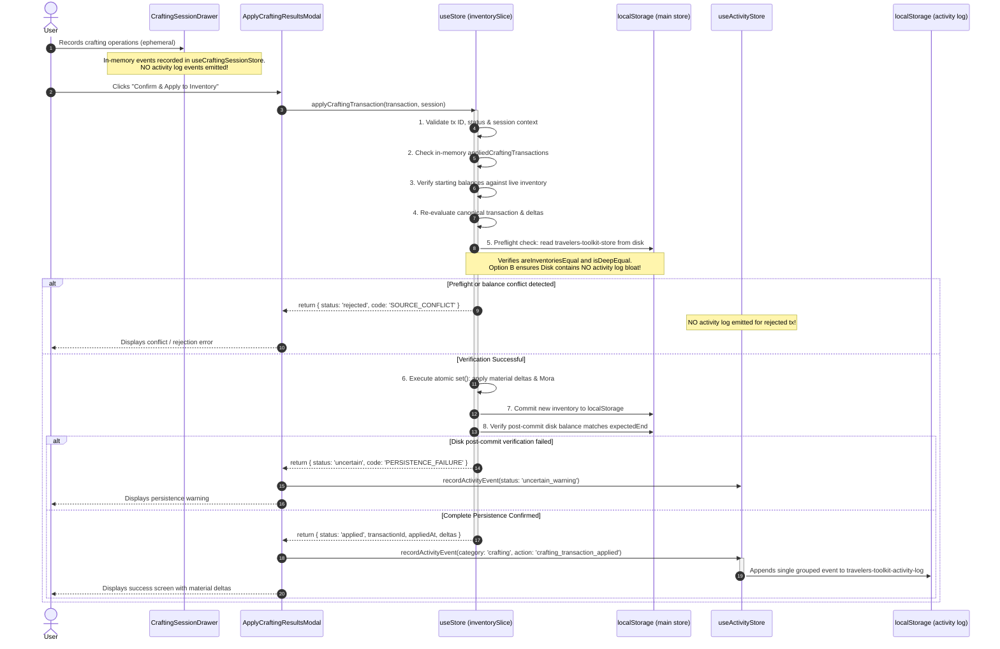
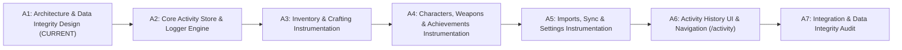

# Traveler's Toolkit — Activity History Architecture & Data Integrity Design
> **Document Status**: Architecture Specification & Decision Record (Phase A1 Final Refinement)  
> **Starting Baseline**: `df52b19`  
> **Target Branch**: `main`  
> **Domain**: System Log / Activity History Subsystem  
> **Author**: Architecture & Data Integrity Review  
> **Approved for Implementation**: Pending Review (Phase A1 Final Refinement)  

---

## 1. Executive Summary

This document establishes the architectural foundation, schema specification, mutation coverage matrix, persistence design, concurrency reliability model, backup interchange specifications, and data integrity safeguards for the **Activity History** feature in *Traveler's Toolkit*.

### 1.1 Core Mission & Scope Realism
Activity History is a persistent, site-wide, local-first informational ledger. It records meaningful user actions, system operations, imports, synchronizations, and applied crafting transactions. It provides users with transparency regarding **what** changed, **when** it changed, and **where** the change originated.

> [!IMPORTANT]
> **Scope & Terminology Realism**:
> This feature is strictly designed and documented as a browser-local **Activity History** for player convenience and transparency. It does **not** claim to provide enterprise-grade compliance audit guarantees, cryptographic non-repudiation, or tamper-proof legal logging. It operates under a bounded, deterministic, best-effort consistency model tailored for a client-side, local-first single-page application.

### 1.2 Explicit Architecture Invariant: No Undo
**The user explicitly does not want Undo functionality.**  
This architecture strictly enforces:
- **NO Undo** buttons, hooks, or state reversals.
- **NO Rollback** commands or mechanisms.
- **NO State restoration** from historical event entries.
- **NO Event replay** engines.
- **NO Reversing** of crafting transactions or material deduction reversal.
- **NO Destructive or mutating controls** masquerading as log actions.

Activity History is strictly an **append-only, informative historical record**.

---

## 2. Architecture Decision Record (ADR: TT-ADR-009)

### Title
**TT-ADR-009: Dedicated Storage Store, Dual-Bound Retention, and Explicit Mutation Instrumentation for Activity History**

### Status
**Proposed (Phase A1 Final Refinement)**

### Context
Traveler's Toolkit is a client-side single-page application (React 19, Zustand 5, Vite, Tailwind CSS). State persistence currently operates through:
1. **Main Store Persistence (`travelers-toolkit-store`)**: Schema version `8`, serialized to browser `localStorage` on state transitions via Zustand's `persist` middleware with `partializeStore`.
2. **Active Crafting Session Store (`useCraftingSessionStore`)**: Strictly in-memory and ephemeral.
3. **Backup System (`travelers-toolkit-backup.json` / Google Drive AppData)**: Schema version `1`, backed by backend FastAPI validation enforcing `extra="forbid"`.
4. **Authoritative Crafting Transaction Engine (`applyCraftingTransaction`)**: Enforces strict starting-balance verification, Mora checks, in-lock duplicate transaction ID suppression, and preflight cross-tab storage consistency checks using `isDeepEqual` across all persisted keys (`src/store/slices/inventorySlice.js:406-418`).

The application requires an activity history ledger that captures user operations without causing performance regressions, risking storage quota exhaustion, or interfering with existing state validation.

### Decision
1. **Adopt Option B (Dedicated Activity Store)**: Store activity history entries in a separate persisted Zustand store (`useActivityStore`) backing to a dedicated `localStorage` key (`travelers-toolkit-activity-log`), completely decoupled from the main application store (`travelers-toolkit-store`).
2. **Explicit Mutation Instrumentation**: Instrument explicit mutation boundaries within existing domain actions and UI commit handlers rather than attaching an uncontrolled global Zustand subscriber.
3. **Non-Blocking Fault Isolation**: If activity logging fails (e.g., storage quota exceeded, JSON parse error), the failure is caught, a diagnostic warning is logged, and the primary domain operation proceeds uninterrupted. A logging failure must never abort or roll back a valid user mutation, nor falsely report a domain error.
4. **Dual-Bound Storage Retention**: Enforce two independent retention limits:
   - **Maximum retained event count**: **1,000 events**.
   - **Target maximum serialized activity history size**: **750 KiB** (768,000 bytes).  
   Prune oldest events FIFO when **either** limit is exceeded. Byte sizing is measured accurately against the serialized UTF-8 payload.
5. **Per-Event Payload Cap & Truncation**: Enforce a target limit of **4 KiB** per individual event. Large bulk operations truncate field diffs while preserving aggregate counts, human summaries, mandatory entity identity, timestamps, transaction IDs, and schema envelopes.
6. **Standalone Versioned Interchange**: Support standalone Activity History JSON export and import (`travelers-toolkit-activity-history` schema version `1`) with runtime schema validation, UUID deduplication, deterministic chronological merging, and timestamp preservation. Importing history **never** modifies domain state (inventory, characters, weapons, achievements).
7. **Cross-Tab & Concurrency Strategy**: Use a Read-Merge-Prune-Write sequence with window `storage` event synchronization and UUID deduplication to provide deterministic, best-effort multi-tab consistency.
8. **No Production Code Changes in A1**: This phase delivers only architectural specifications and data integrity designs. No production code, Zustand persistence schema version (`8`), or backup schema version (`1`) are modified.

### Consequences
- **Positive**:
  - Zero risk of causing `STORAGE_SOURCE_MISMATCH` false rejections in `applyCraftingTransaction`.
  - Main store persistence schema remains at version `8`; no migrations required for existing user data.
  - Serialization of high-frequency domain updates remains instantaneous; no deep cloning or serialization of large event arrays during regular app use.
  - Full isolation from Google Drive backup schema version `1` (which rejects unknown fields with HTTP 422).
  - Clear separation of concerns: domain stores manage current truth; activity store manages historical audit trail.
- **Negative / Trade-offs**:
  - Separate `localStorage` keys do not provide ACID atomicity across stores; an abrupt browser crash between domain commit and log write could record the domain update without the corresponding log entry.
  - Restoring a domain backup does not retroactively rewrite historical logs (which is desired behavior, but requires explicit documentation).

---

## 3. Event Schema Specification

The event schema is designed to be versioned, strongly typed, compact, and resilient against runtime schema shifts.

### 3.1 TypeScript Interface Definition

```typescript
/**
 * Canonical Activity History Event Schema (Version 1)
 */
export interface ActivityEvent {
  /** Unique UUID v4 for the event */
  id: string;

  /** Schema version of the event structure */
  schemaVersion: 1;

  /** Canonical ISO-8601 UTC timestamp of when the change was committed */
  timestamp: string;

  /** High-level operational category */
  category: ActivityCategory;

  /** Specific action performed */
  action: ActivityAction;

  /** Component or workflow where the change originated */
  source: ActivitySource;

  /** Canonical entity type classification */
  entityType?: ActivityEntityType;

  /** Canonical entity identity (e.g. material ID, character name, weapon UUID, achievement ID) */
  entityId?: string;

  /** Canonical human-readable entity display name */
  entityName?: string;

  /** Concise, human-readable summary of the committed change */
  summary: string;

  /** Granular before/after differences for affected fields */
  changes?: FieldChange[];

  /** Domain-specific structured metadata */
  metadata?: Record<string, unknown>;

  /** Associated transaction ID for crafting or bulk transactions */
  transactionId?: string;

  /** Indicates if field-level changes were truncated due to per-event size limits */
  truncated?: boolean;
}

export type ActivityCategory =
  | 'inventory'
  | 'characters'
  | 'weapons'
  | 'achievements'
  | 'crafting'
  | 'import_sync'
  | 'settings_system'
  | 'goals';

export type ActivityEntityType =
  | 'material'
  | 'character'
  | 'weapon'
  | 'achievement'
  | 'crafting_transaction'
  | 'backup'
  | 'sync_session'
  | 'setting'
  | 'goal';

export type ActivitySource =
  | 'inventory_page'
  | 'planner_inline'
  | 'character_modal'
  | 'characters_table'
  | 'character_bulk_edit'
  | 'armory_modal'
  | 'weapons_table'
  | 'weapons_bulk_edit'
  | 'achievements_page'
  | 'achievements_settings'
  | 'crafting_results_modal'
  | 'settings_good_import'
  | 'settings_backup'
  | 'settings_cloud_sync'
  | 'settings_preferences'
  | 'hoyolab_character_sync'
  | 'dashboard_quick_add'
  | 'activity_history_import'
  | 'system';

export type ActivityAction =
  // Inventory
  | 'inventory_updated'
  | 'inventory_incremented'
  | 'inventory_decremented'
  | 'inventory_bulk_updated'
  // Characters
  | 'character_added'
  | 'character_removed'
  | 'character_updated'
  | 'characters_batch_added'
  | 'characters_batch_removed'
  | 'characters_bulk_updated'
  // Weapons
  | 'weapon_added'
  | 'weapon_removed'
  | 'weapon_updated'
  | 'weapons_batch_removed'
  | 'weapons_bulk_updated'
  | 'weapon_assigned'
  | 'weapon_unassigned'
  // Achievements
  | 'achievement_completed'
  | 'achievement_uncompleted'
  | 'achievements_imported_replace'
  | 'achievements_imported_merge'
  | 'achievements_cleared'
  | 'achievements_stage_cascade'
  // Crafting
  | 'crafting_transaction_applied'
  | 'crafting_transaction_uncertain'
  // Imports & Sync
  | 'good_import_applied'
  | 'local_backup_restored'
  | 'cloud_backup_restored'
  | 'hoyolab_character_sync_applied'
  | 'cloud_backup_created'
  | 'cloud_backup_failed'
  | 'activity_history_imported'
  // Settings & System
  | 'server_region_changed'
  | 'display_timezone_changed'
  | 'auto_backup_toggled'
  | 'db_builder_toggled'
  | 'factory_reset_performed'
  // Goals
  | 'goal_added'
  | 'goal_removed';

export interface FieldChange {
  /** Property or field path that changed (e.g. 'quantity', 'level', 'targetLevel', 'talents.skill') */
  field: string;

  /** Human-readable field label (e.g. 'Level', 'Normal Attack', 'Refinement') */
  label?: string;

  /** State prior to mutation */
  before: unknown;

  /** State immediately following successful mutation */
  after: unknown;

  /** Formatted delta or difference (e.g. '+1,089', '-14,400', '+1') */
  delta?: string | number;
}

/**
 * Standalone Activity History File Interchange Envelope (Version 1)
 */
export interface ActivityHistoryExportPayloadV1 {
  app: 'travelers-toolkit';
  format: 'travelers-toolkit-activity-history';
  schemaVersion: 1;
  exportedAt: string; // ISO-8601 UTC timestamp
  eventCount: number;
  events: ActivityEvent[];
}
```

### 3.2 Schema Rules & Compactness Constraints
1. **No Full Store Snapshots**: Events must store only granular differences in `changes`. Storing whole roster objects, whole armory arrays, or complete inventory maps is strictly prohibited.
2. **Defensive Normalization**: Before an event is committed to storage, it passes through a runtime validator (`validateActivityEvent`) that asserts required string lengths, valid ISO timestamps, UUID format, and sanitizes payload sizes.
3. **Per-Event Cap & Field Truncation Rules**:
   - Target maximum per-event serialized payload: **4 KiB** (4,096 bytes).
   - If a bulk operation mutates many items (e.g., a massive GOOD import affecting 100+ materials and characters):
     - The event keeps up to the first **50** item diffs in `changes`.
     - Remaining items are omitted from `changes`.
     - The event sets `truncated: true`.
     - Structured metadata stores aggregate statistics: `metadata.totalMutatedItems`, `metadata.recordedMutatedItems: 50`.
   - **MANDATORY FIELD INTEGRITY INVARIANT**:  
     Mandatory event fields (`id`, `schemaVersion`, `timestamp`, `category`, `action`, `source`, `summary`, and `transactionId`) **must NEVER be truncated or omitted**. Truncation applies strictly to verbose arrays within `changes` and optional auxiliary metadata.
   - The top-level human-readable `summary` must always describe the full mutation scope (e.g., *"GOOD import: 84 materials, 12 characters, and 6 weapons updated"*).

---

## 4. Repository-Wide Mutation & Event Coverage Matrix

Every mutation entry point in Traveler's Toolkit has been inspected in the current codebase (`df52b19`). The table below maps verified repository implementations to their exact logging specifications.

| Domain | Action / Function | Source File & Location | Verified Baseline Behavior | Proposed Event & Action | Captured Changes & Metadata | Suppression & No-Op Conditions |
| :--- | :--- | :--- | :--- | :--- | :--- | :--- |
| **Inventory** | `setInventory(mat, qty)` | `src/store/slices/inventorySlice.js:55` | Clamps quantity `Math.max(0, qty)` and assigns to `inventory[mat]`. | `inventory_updated` (or `inventory_incremented` / `decremented` when triggered via stepper) | `field: 'quantity'`, `before: prevQty`, `after: nextQty`, `delta: nextQty - prevQty`. Metadata: `materialKey: mat`. | Suppress if `prevQty === nextQty`. Suppress non-numeric inputs. In `Inventory.jsx`, commit on blur/Enter/stepper only; never log keystrokes. |
| **Inventory** | `incrementInventory(mat, amount)` | `src/store/slices/inventorySlice.js:60` | Increments `inventory[mat]` by `amount`. | `inventory_incremented` / `decremented` | `field: 'quantity'`, `before: prevQty`, `after: nextQty`, `delta: amount`. | Suppress if `amount === 0`. |
| **Inventory** | Inline Have Input | `src/components/Planner/PlannerInventoryQuantityInput.jsx:111` | Validates trimmed input, checks idempotency (`newQty === liveStoredQty`), checks conflict, then calls `saveQuantity`. | `inventory_updated` | `field: 'quantity'`, `before: initialValue`, `after: newQty`, `delta: newQty - initialValue`. Source: `planner_inline`. | Suppressed on keystroke (`onChange` only updates local draft). Idempotent edits suppressed (`newQty === liveStoredQty`). |
| **Inventory** | Stepper Card Buttons | `src/pages/Inventory.jsx:35` | Calls `setInventory(matKey, Math.max(0, qty + delta))`. | `inventory_incremented` / `decremented` | `field: 'quantity'`, `before: qty`, `after: newQty`, `delta: ±1`. Source: `inventory_page`. | Suppress if already 0 and stepping -1. |
| **Characters** | `addCharacter(name)` | `src/store/slices/rosterSlice.js:8` | Initializes character with level 1, target 90, talents 1/1/1, targets 10/10/10. No-ops if already in roster. | `character_added` | `entityId: name`, `entityName: name`. Metadata: `initialLevel: 1, targetLevel: 90`. | Suppress if `state.roster[name]` already exists (`if (state.roster[name]) return state`). |
| **Characters** | `saveCharacterDraft(name, draft)` | `src/store/slices/rosterSlice.js:29` | Replaces level, ascension, targets, talents, target talents, and weapon linkage in one atomic `set()`. | `character_updated` | Single grouped event. `changes`: array of changed fields (`level`, `targetLevel`, `talents.normal`, `equippedWeaponId`, etc.). | Suppress if all draft fields match existing character state exactly. |
| **Characters** | `updateCharacter(name, patch)` | `src/store/slices/rosterSlice.js:190` | Normalizes patch, recalculates costs, updates character in roster. Used for table cell edits. | `character_updated` | `changes`: array of patched fields. Source: `characters_table`. | Suppress if `normalizeCharacterPatch` results in zero field differences against current state. |
| **Characters** | `batchAddCharacters(namesArray)` | `src/store/slices/rosterSlice.js:140` | Adds all non-existing characters from array. Syncs Traveler ascension. | `characters_batch_added` | Single summary event. `metadata: { addedCount, characterNames }`. | Suppress if `hasChanges === false` (all requested characters were already tracked). |
| **Characters** | `removeCharacter(name)` | `src/store/slices/rosterSlice.js:167` | Deletes character from `roster`, unassigns any weapon assigned to this character. | `character_removed` | `entityId: name`, `metadata: { unassignedWeaponId }`. | Suppress if character not in roster. |
| **Characters** | `batchRemoveCharacters(names)` | `src/store/slices/rosterSlice.js:178` | Deletes multiple characters, unassigns weapons. | `characters_batch_removed` | Single summary event. `metadata: { removedCount, characterNames }`. | Suppress if `names` array is empty or none were in roster. |
| **Characters** | `bulkUpdateCharacters(payloads, patch)` | `src/store/slices/rosterSlice.js:209` | Updates multiple characters simultaneously from modal or table bulk action. | `characters_bulk_updated` | Single bulk event. `metadata: { count: targetNames.length, modifiedFields: Object.keys(patch) }`. | Suppress if `hasChanges === false`. |
| **Weapons** | `addTrackedWeapon(weaponName, assignedTo, config)` | `src/store/slices/weaponsSlice.js:8` | Instantiates weapon with UUID, level 1 (or config), target 90, refinement 1, bidirectional roster linkage. | `weapon_added` | `entityId: id`, `entityName: weaponName`, `metadata: { level, targetLevel, assignedTo, refinement }`. | Generates UUID; preserves distinct identity for identical weapon copies. |
| **Weapons** | `removeTrackedWeapon(id)` | `src/store/slices/weaponsSlice.js:66` | Deletes weapon from `trackedWeapons`, clears `equippedWeaponId` from previous owner. | `weapon_removed` | `entityId: id`, `entityName: weaponName`, `metadata: { unassignedFrom: weapon.assignedTo }`. | Suppress if weapon ID does not exist in store. |
| **Weapons** | `batchRemoveWeapons(ids)` | `src/store/slices/weaponsSlice.js:85` | Removes array of weapon IDs, clears character linkages. | `weapons_batch_removed` | Single summary event. `metadata: { removedCount: ids.length, weaponIds: ids }`. | Suppress if `ids` array is empty. |
| **Weapons** | `updateTrackedWeapon(id, patch)` | `src/store/slices/weaponsSlice.js:105` | Normalizes patch, updates levels, ascension, refinement (0-5), recalculates costs, handles weapon swapping. | `weapon_updated` | `entityId: id`, `entityName: weapon.weaponName`, `changes`: diffs for level, ascension, refinement, or owner. | Suppress if normalized patch matches current weapon properties. |
| **Weapons** | `bulkUpdateWeapons(ids, patch)` | `src/store/slices/weaponsSlice.js:183` | Applies normalized patch to multiple weapon instances. | `weapons_bulk_updated` | Single bulk event. `metadata: { updatedCount, affectedWeaponNames }`. | Suppress if no weapons modified. |
| **Weapons** | `assignWeaponToCharacter(weaponId, charName)` | `src/store/slices/weaponsSlice.js:249` | Unassigns previous weapons bidirectionally, links weapon to character. | `weapon_assigned` | `entityId: weaponId`, `entityName: weapon.weaponName`, `changes: [{ field: 'assignedTo', before: prevOwner, after: charName }]`. | Suppress if already assigned to `charName`. |
| **Weapons** | `unassignWeapon(weaponId)` | `src/store/slices/weaponsSlice.js:286` | Clears `assignedTo` and character `equippedWeaponId`. | `weapon_unassigned` | `entityId: weaponId`, `changes: [{ field: 'assignedTo', before: prevOwner, after: null }]`. | Suppress if weapon was already unassigned. |
| **Achievements** | `setAchievementCompleted(id, completed)` | `src/store/slices/achievementSlice.js:6` | If completed: creates `{ completed: true, completedAt: iso }`. If false: deletes key. Preserves existing `completedAt`. | `achievement_completed` / `achievement_uncompleted` | `entityId: id`, `entityName: canonicalName`, `metadata: { completedAt: entry.completedAt, primogems }`. | Suppress if `isValidAchievementId(id)` is false or state already matches. |
| **Achievements** | `handleToggle(id, checked)` | `src/pages/Achievements.jsx:196` | Evaluates multi-stage cascade via `applyStageCompletionChange`, commits via `setAchievementProgress`. | `achievements_stage_cascade` (or single completion) | Single grouped event listing primary toggle and cascaded completions with canonical IDs. | Suppress if no effective changes produced. |
| **Achievements** | `setAchievementProgress(entries, options)` | `src/store/slices/achievementSlice.js:37` | Replaces or merges full achievement progress dictionary. Normalizes stage constraints. | `achievements_imported_replace` / `achievements_imported_merge` | Single summary event. `metadata: { mode: options.mode, validCount, unknownSkippedCount }`. | Suppress if parsed entries produce no changes. |
| **Achievements** | `clearAchievementProgress()` | `src/store/slices/achievementSlice.js:59` | Sets `achievementProgress: {}`. | `achievements_cleared` | `metadata: { clearedCompletionsCount: previousCount }`. | Suppress if store was already `{}`. |
| **Crafting** | `applyCraftingTransaction(tx, session)` | `src/store/slices/inventorySlice.js:84` | Revalidates canonical transaction, starting balances, Mora, duplicate tx IDs, cross-tab disk consistency, applies deltas atomically. | `crafting_transaction_applied` | `transactionId: tx.transactionId`, `metadata: { familyId, totalOperations, totalBatches, totalMoraSpent, bonusType }`, `changes: [material & Mora deltas]`. | **Log ONLY when outcome status is `applied`. NEVER log rejected transactions. NEVER log ephemeral drawer drafts.** |
| **Imports & Sync** | `importGoodData(goodPayload)` | `src/store/slices/importSlice.ts:48` | Merges materials, updates roster preserving targets, merges weapons preserving IDs. | `good_import_applied` | Single summary event. `metadata: { materialsUpdated: M, charactersUpdated: C, weaponsUpdated: W, unresolvedCount }`. | Suppress if GOOD payload contains no valid entries. |
| **Imports & Sync** | `importData(data)` (Backup Restore) | `src/store/slices/importSlice.ts:39` | Replaces roster, weapons, inventory, settings, and achievementProgress from validated v1 backup. | `local_backup_restored` / `cloud_backup_restored` | Single summary event. `source: 'settings_backup' \| 'settings_cloud_sync'`, `metadata: { rosterCount, armoryCount, materialsCount }`. | Suppress if data validation fails. |
| **Imports & Sync** | `applyHoyolabSync(plan)` | `src/store/slices/hoyolabSyncSlice.js:5` | Applies HoYoLAB character/weapon progression via atomic `set()`, updates `lastHoyolabCharacterSyncAt`. | `hoyolab_character_sync_applied` | Single summary event. `metadata: { charactersUpdated, weaponsSynced, timestamp }`. | Suppress if sync plan has no actionable differences. |
| **Imports & Sync** | Cloud Backup Creation | `src/pages/Settings.jsx:325` | Uploads manual backup to Google Drive AppData folder. | `cloud_backup_created` | Operational event. `metadata: { backupFileName, timestamp }`. | Never log Google auth tokens or credentials. |
| **Settings** | `setServerRegion(region)` | `src/store/slices/settingsSlice.js:3` | Updates `serverRegion`. | `server_region_changed` | `field: 'serverRegion'`, `before: prevRegion`, `after: region`. | Suppress if `prevRegion === region`. |
| **Settings** | `setDisplayTimeZone(zone)` | `src/store/slices/settingsSlice.js:9` | Updates `displayTimeZone`. | `display_timezone_changed` | `field: 'displayTimeZone'`, `before: prevZone`, `after: zone`. | Suppress if `prevZone === zone`. |
| **Settings** | `setAutoBackupEnabled(val)` | `src/store/slices/settingsSlice.js:7` | Toggles `autoBackupEnabled`. | `auto_backup_toggled` | `field: 'autoBackupEnabled'`, `before: prevVal`, `after: val`. | Suppress if `prevVal === val`. |
| **Settings** | `setShowDbBuilder(show)` | `src/store/slices/settingsSlice.js:5` | Toggles DB builder nav link. | `db_builder_toggled` | `field: 'showDbBuilder'`, `before: prevVal`, `after: show`. | Suppress if unchanged. |
| **Goals** | `addGoal` / `removeGoal` | `src/store/slices/goalsSlice.js:4,9` | Adds/removes goal record from `goals` array. | `goal_added` / `goal_removed` | `entityId: goal.charName`, `changes: [goal payload]`. | Suppress if no-op. (Note: Modern UI uses character target levels; goals slice is legacy). |
| **System** | `resetStore()` (Factory Reset) | `src/store/slices/importSlice.ts:184` | Wipes all user roster, weapons, inventory, goals, achievements, and settings to defaults. | `factory_reset_performed` | Recorded as the reset event in history. | Requires explicit confirmation dialog. |

---

## 5. Actions That Must NOT Generate Activity (Suppression Matrix)

The activity history must be clean, readable, and actionable. It must not degrade into a noisy debugging trace. The following actions are **strictly prohibited** from emitting activity events:

1. **Navigation & Route Changes**: Moving between `/`, `/planner`, `/inventory`, `/achievements`, `/settings`, `/changelog`.
2. **View State & Scrolling**: Scrolling lists, switching planner tabs (`daily_action`, `currency_exp`, etc.), opening or closing drawers/modals, acquiring body scroll locks.
3. **Draft Input & Keystrokes**: Typing into search boxes, filter inputs, or quantity fields prior to an explicit `Save`, `Enter` keypress, or blur event.
4. **Transient Calculation State**: Rederiving costs in `aggregator.js`, `calculator.js`, or calculating planner surplus matrices.
5. **Active Crafting Session Drafts**: Ephemeral crafting ledger changes (`startSession`, `recordResult`, `undoLastBatch`, `acknowledgeConflict`, `restartSession`, `discardSession`) inside `useCraftingSessionStore`. Only the final confirmed, successfully applied inventory transaction is logged.
6. **Rejected or Invalid Mutations**: Any transaction or form submission rejected by validation (e.g. insufficient Mora, invalid character ID, duplicate submission).
7. **Idempotent Updates (No-Ops)**: Submitting a form or setting a store property where the resulting state is mathematically and structurally identical to the preceding state.
8. **Zustand Hydration**: Initial load from `localStorage` into memory.
9. **Persistence Migrations**: Schema transformations executed inside `migrateStore` (e.g. upgrading v6 to v7).
10. **Background Automation & Resin Timers**: Natural regeneration of Original Resin (1 resin per 8 minutes), automated background synchronization polling, and token refresh heartbeats.

---

## 6. Persistence Architecture & Trade-Off Analysis

Three storage approaches were evaluated for Traveler's Toolkit.

```mermaid
graph TD
    subgraph Option A [Option A: Monolithic Zustand Store]
        StoreA[travelers-toolkit-store] --> DiskA[localStorage: travelers-toolkit-store]
        DiskA -.-> |Every Mutation Serializes Entire History| HeavyDiskA[Heavy Disk I/O & Quota Pressure]
        StoreA -.-> |Breaks Crafting isDeepEqual Check| ConflictA[STORAGE_SOURCE_MISMATCH]
    end

    subgraph Option B [Option B: Dedicated Activity Store (RECOMMENDED)]
        StoreB[travelers-toolkit-store v8] --> DiskB[localStorage: travelers-toolkit-store]
        ActStore[useActivityStore v1] --> ActDisk[localStorage: travelers-toolkit-activity-log]
        ActStore -.-> |Dual-Bound FIFO: 1,000 events / 750 KiB| CleanDisk[Bounded Storage]
        StoreB --- |100% Isolated - No Crafting Regressions| ActStore
    end

    subgraph Option C [Option C: IndexedDB Journal]
        StoreC[travelers-toolkit-store v8] --> DiskC[localStorage]
        ActIDB[IndexedDB: travelers-toolkit-activity-db]
        StoreC -.-> |Async / Non-Atomic Storage Mismatch| AsyncSplit[Sync vs Async Failure Modes]
    end
```

### 6.1 Detailed Options Evaluation

| Evaluation Criteria | Option A: Main Zustand Store (`travelers-toolkit-store`) | Option B: Dedicated Activity Store (`travelers-toolkit-activity-log`) | Option C: IndexedDB Journal (`travelers-toolkit-activity-db`) |
| :--- | :--- | :--- | :--- |
| **Isolation from Main Store** | **None.** Merged into `partializeStore`. Bumps store version to `v9`. | **Complete.** Dedicated store and separate `localStorage` key. Store stays at `v8`. | **Complete.** Stored in browser IndexedDB database. Store stays at `v8`. |
| **Impact on Crafting Safeguards** | **CRITICAL RISK.** `applyCraftingTransaction` executes `isDeepEqual` across all persisted keys against raw disk parsed JSON (`lines 406-418`). Adding a high-frequency array causes false `STORAGE_SOURCE_MISMATCH` rejections. | **ZERO RISK.** Main store persistence snapshot is byte-for-byte identical. Crafting checks pass unmodified. | **ZERO RISK.** Crafting store checks remain completely independent. |
| **Serialization Overhead** | **Severe.** Every single inventory step or checkbox click re-serializes hundreds of historical log entries to disk. | **Optimal.** Main store serializes in <1ms. Activity store serializes only when a real activity event is logged. | **Optimal.** Writes append asynchronously to object store. |
| **Cross-Tab Consistency** | Shared storage listener triggers whole-state reload on log append. | Native `storage` event syncs activity log across tabs without touching domain state. | Handled via BroadcastChannel or IDB transaction events. |
| **Storage Quota & Failure Behavior** | If history bloats, main domain state fails to persist. High data loss risk. | Dual-bound FIFO pruning caps history at 1,000 events and 750 KiB. If quota throws, domain updates still persist cleanly. | High quota (50MB+), but suffers from async error handling complexity. |
| **Backup Compatibility** | **Breaks Backup Schema v1.** Backend `BackupData` enforces `extra="forbid"`. Would require backend FastAPI migration. | **Safe.** Domain backup schema remains at `v1`. Activity log can be exported independently. | **Safe.** Domain backup schema remains at `v1`. |
| **Third-Party Dependencies** | None. | None (built with existing Zustand + React). | Requires raw IDB boilerplate or external dependencies (forbidden by guidelines). |

### 6.2 Architectural Recommendation
**Option B is unambiguously selected.**  
It provides total isolation for the authoritative crafting transaction engine, requires no breaking migrations to store version `8` or backup schema version `1`, guarantees deterministic storage bounds (1,000 events / 750 KiB), and ensures that logging failures can never corrupt or block primary user progression.

---

## 7. Logging Consistency, Mutation Boundaries & Concurrency Model

### 7.1 Centralized Recording Engine (`activityLogger`)
Logging is governed by a centralized helper rather than ad-hoc writes or uncontrolled subscribers:

```typescript
/**
 * Core logging dispatch contract
 */
export function recordActivityEvent(input: Omit<ActivityEvent, 'id' | 'timestamp' | 'schemaVersion'>): void {
  try {
    // 1. Validate mandatory fields
    if (!input.category || !input.action || !input.summary) {
      console.warn('[ActivityLogger] Dropping invalid event: missing required fields.', input);
      return;
    }

    // 2. Synthesize canonical metadata
    const event: ActivityEvent = {
      ...input,
      id: crypto.randomUUID(),
      schemaVersion: 1,
      timestamp: new Date().toISOString(),
      changes: input.changes?.filter(c => c.before !== c.after), // Strict no-op field purge
    };

    // 3. Dispatch to dedicated store
    useActivityStore.getState().appendEvent(event);
  } catch (err) {
    // 4. Non-blocking failure containment
    console.error('[ActivityLogger] Failed to record activity event:', err);
  }
}
```

### 7.2 Non-Blocking Fault Containment Rule
A fundamental invariant of the logging subsystem:
> **A failure in Activity History must never cause a user transaction or domain mutation to fail.**

If `localStorage.setItem` throws a `QuotaExceededError` or JSON serialization fails during logging:
1. The error is caught within `activityLogger`.
2. An internal error diagnostic counter is incremented (`logPersistenceErrors`).
3. An automatic pruning pass is triggered (dropping the oldest 20% of log entries).
4. **The user's domain mutation (inventory change, character level-up, crafting application) succeeds completely.**
5. The application UI must **never** report to the user that their inventory or character update failed when only the activity log write encountered an issue.

### 7.3 Concurrency, Stale Snapshots & Cross-Tab Reconciliation
Because `localStorage` does not support cross-key multi-statement transactions, the activity logging engine implements a **Read-Merge-Prune-Write** cycle:

1. **Multi-Tab Writing**:
   - When Tab A writes an event to `travelers-toolkit-activity-log`, Tab B receives a native browser `window.addEventListener('storage', ...)` event.
   - Tab B re-reads the serialized payload from disk and reconciles its in-memory store.
2. **Read-Merge-Prune-Write on Commit**:
   - To prevent Tab A from overwriting entries written milliseconds earlier by Tab B using a stale in-memory array, `appendEvent` immediately reads the latest raw disk string from `localStorage`, parses existing IDs into a lookup map, inserts the new event, resolves any duplicates, applies dual retention limits (1,000 events / 750 KiB), and writes back.
3. **Duplicate Event ID Protection**:
   - All events are generated with `crypto.randomUUID()`.
   - Merging uses a deterministic `Map<string, ActivityEvent>` keyed by `event.id`, ensuring duplicate submissions or replay attempts are idempotent no-ops.
4. **Storage Event Reconciliation**:
   - If storage events arrive out-of-order, the store sorts the reconciled array deterministically:
     - **Primary sort**: ISO-8601 `timestamp` ascending (oldest to newest for storage, reversed for display).
     - **Secondary tie-breaker**: Canonical `event.id` string comparison (ensuring 100% deterministic ordering for events committed within the same millisecond).
5. **Browser Crash Between Domain Mutation and Logging**:
   - If the browser process terminates abruptly after `travelers-toolkit-store` commits to disk but before `travelers-toolkit-activity-log` commits:
     - The domain change (e.g. inventory increment, character level) is fully preserved.
     - The specific activity history record for that change is lost.
   - This best-effort consistency is documented and explicitly accepted for a browser-local activity log. It avoids heavy, fragile two-phase commit overhead in the browser.

---

## 8. Special Safety Requirement: Crafting Transactions Integration

The crafting transaction system (`applyCraftingTransaction` in `src/store/slices/inventorySlice.js:84`) is the most sensitive data integrity boundary in Traveler's Toolkit. It incorporates cryptographic-style ledger fingerprinting, exact starting balance assertions, and storage disk preflight verification.

### 8.1 Crafting Transaction Execution & Logging Sequence



### 8.2 Specific Crafting Guarantees
1. **No Intermediate Drawer Logging**: As a user clicks "Craft", adjusts counts, or tests character bonus configurations inside `CraftingSessionDrawer`, the ephemeral events in `useCraftingSessionStore` emit **zero** activity events.
2. **Rejected Transactions Suppressed**: If a transaction fails validation or is rejected due to concurrent external changes (`SOURCE_CONFLICT`, `STORAGE_SOURCE_MISMATCH`, `DUPLICATE_TRANSACTION`), **no** activity entry is created claiming inventory was changed.
3. **Single Grouped Event**: When a transaction is confirmed and applied, it produces exactly **one** grouped event containing:
   - `transactionId`: Canonical UUID from the crafting engine.
   - `metadata.familyId`: Material group crafted (e.g. `phosphosiderite`).
   - `metadata.totalOperations`: Total craft steps performed.
   - `metadata.totalBatches`: Total discrete batches.
   - `metadata.totalMoraSpent`: Total Mora deducted.
   - `metadata.bonusType`: Active character bonus (e.g. `albedo_double` or `sucrose_refund`).
   - `changes`: Full array of negative ingredient deltas and positive output deltas.
4. **Handling Uncertain Outcomes**: If `applyCraftingTransaction` returns `status: 'uncertain'` (memory updated but disk write verification failed), the logging system records a distinct diagnostic event: `action: 'crafting_transaction_uncertain'`. It never misreports an uncertain transaction as a cleanly persisted application.

---

## 9. Backup, Restore, Interchange & Reset Policy

### 9.1 Lifecycle Event Matrix

| Scenario | Application Action | Activity History Behavior | Integrity Rule |
| :--- | :--- | :--- | :--- |
| **1. Browser Refresh** | Zustand rehydrates stores from `localStorage`. | `useActivityStore` loads `travelers-toolkit-activity-log` seamlessly. | No rehydration events logged. State loads synchronously. |
| **2. Tab Close & Reopen** | Standard browser restart. | Preserved across sessions up to dual retention bounds. | Chronological order maintained by UTC timestamp. |
| **3. Local JSON Backup** | User exports `travelers-toolkit-backup.json` from Settings. | Backs up domain data (Schema v1). Activity history remains client-side. | Does not modify backup schema v1; keeps backend Pydantic models valid. |
| **4. Local JSON Restore** | User imports `travelers-toolkit-backup.json`. | Domain state is restored. A single summary event is recorded: `action: 'local_backup_restored'`. | **Never wipes historical logs.** Newer client activity created after the backup timestamp is preserved. |
| **5. Google Drive Auto/Manual Backup** | Syncs domain state to Drive AppData folder. | Domain state uploaded. Records operational event `cloud_backup_created` (success) or `cloud_backup_failed` (failure). | Never captures OAuth tokens, refresh tokens, or user emails. |
| **6. Google Drive Restore** | Downloads recovery or manual backup from Drive. | Restores domain state. Records single event: `action: 'cloud_backup_restored'`. | Summary includes backup date and restored counts. |
| **7. GOOD Format Import** | User imports Inventory Kamera JSON file. | Domain merges materials, roster, and armory. Records single summary event: `action: 'good_import_applied'`. | Does not emit hundreds of individual events. Groups all changes under one expandable entry. |
| **8. Factory Reset** | User clicks "Factory Reset" in Settings Danger Zone. | Clears domain store (`resetStore()`). Prompts user whether to clear history or retain audit trail; if cleared, records initial entry `factory_reset_performed`. | Complete reset returns all storage keys to factory baseline. |
| **9. Restoring Older Backups** | Restoring a backup created before Activity History existed. | Domain data restores cleanly. Activity history begins recording from that moment forward. | Never fabricates synthetic retroactive history entries for past dates. |

### 9.2 Cloud Backup Separation Notice
> [!NOTE]
> Initial Activity History is strictly **browser-local** and is **not automatically included in Google Drive cloud backups**.  
> The existing Google Drive backup backend enforces schema version `1` with `model_config = ConfigDict(extra="forbid")`. Adding activity history to cloud backups without coordinating a backend migration would break cloud backup sync with HTTP 422 errors. Automated cloud backup of history is deferred to a future backend-coordinated phase.

### 9.3 Standalone Activity History Export & Import Workflow

To provide data portability across browsers and devices without modifying the domain backup schema, Activity History includes a dedicated standalone interchange mechanism:

#### Export Specification
- **User Action**: "Export Activity History (.json)" button on `/activity` page.
- **Output File**: `travelers-toolkit-activity-history-YYYY-MM-DD.json`.
- **Payload Structure**:
  ```json
  {
    "app": "travelers-toolkit",
    "format": "travelers-toolkit-activity-history",
    "schemaVersion": 1,
    "exportedAt": "2026-11-12T12:00:00.000Z",
    "eventCount": 42,
    "events": [ ... ]
  }
  ```

#### Import Specification & Strict Invariants
- **User Action**: "Import Activity History" file picker on `/activity` page.
- **CRITICAL INVARIANT 1**: **Historical event imports must NEVER be interpreted as newly performed inventory or progression actions.**
- **CRITICAL INVARIANT 2**: **The import feature must NEVER modify roster, inventory, weapons, achievements, or any other domain data.** It imports strictly into the informational Activity History ledger.
- **Import Validation & Execution Pipeline**:
  1. **Envelope Validation**: Assert `payload.app === 'travelers-toolkit'`, `payload.format === 'travelers-toolkit-activity-history'`, and `payload.schemaVersion === 1`.
  2. **Record-Level Defensive Validation**:
     - Iterate through `payload.events`.
     - Validate mandatory fields: `id` (string), `timestamp` (valid parseable ISO string), `category`, `action`, `source`, `summary`.
     - Skip corrupt or invalid entries; increment `skippedMalformedCount`.
  3. **Event ID Deduplication**:
     - Events matching existing local event IDs are deduplicated idempotently (preserving existing entries).
  4. **Preservation of Original Timestamps**:
     - Imported historical events strictly retain their original `timestamp`. They are **never** re-stamped with the current import time.
  5. **Deterministic Chronological Merge**:
     - Combine valid new imported events with existing local events.
     - Sort all events deterministically: primary sort by `timestamp` ascending, tie-breaker by `id` lexicographically.
  6. **Retention Enforcement**:
     - Apply dual retention limits (1,000 count and 750 KiB serialized size) to the merged collection. If the merged output exceeds either limit, the oldest events are pruned FIFO.
  7. **Summary Event**:
     - Record a single internal activity event: `action: 'activity_history_imported'`, metadata: `{ importedCount, skippedMalformedCount, deduplicatedCount }`.
  8. **User Feedback**:
     - Display a notification reporting the exact number of imported, deduplicated, and skipped entries.

---

## 10. Retention Strategy & Storage Budget

### 10.1 Dual-Bound Retention Limits
To prevent browser storage exhaustion while maximizing useful history for users, the storage engine enforces **two independent bounds**:

1. **Maximum Retained Event Count**: **1,000 events**.
2. **Target Maximum Serialized Size**: **750 KiB** (768,000 bytes).

Whenever an event is added or imported:
- If `events.length > 1,000`, the oldest entries are pruned until count ≤ 1,000.
- If the serialized JSON byte size exceeds 750 KiB, the oldest entries are pruned until size ≤ 750 KiB.

### 10.2 Accurate Serialized Size Measurement
Naive JavaScript `string.length` measures UTF-16 code units, not actual byte consumption in storage, undercounting multi-byte UTF-8 characters (e.g. non-Latin character names, symbols, and emojis) and ignoring JSON syntax overhead.

The size calculation will be measured accurately:
```typescript
/**
 * Calculates accurate UTF-8 serialized byte size
 */
export function getSerializedByteSize(data: unknown): number {
  const jsonString = typeof data === 'string' ? data : JSON.stringify(data);
  if (typeof TextEncoder !== 'undefined') {
    return new TextEncoder().encode(jsonString).length;
  }
  // Fallback for older test environments
  return new Blob([jsonString]).size;
}
```

### 10.3 Emergency Quota Eviction
If a write throws `QuotaExceededError`:
1. The logging engine catches the error without bubbling to the caller.
2. An emergency eviction pass is triggered, dropping the oldest 30% of events.
3. The store re-evaluates the dual limits and retries writing to `localStorage`.
4. If the retry fails, the event write is dropped for that session, an in-memory alert flag is set, and **the user's domain mutation completes without interruption**.

---

## 11. User Interface & Navigation Specification (`/activity`)

### 11.1 Route & Navigation Placement
- **Route**: `/activity`
- **Navigation Label**: **Activity History**
- **Sidebar Location**: Placed within the **Records** section directly below **Achievements** in `AppLayout.jsx` (`navSections`):

```text
Progression
  Dashboard
  Characters
  Weapons
  Planner
  Inventory
Records
  Achievements
  Activity History    <-- (New Top-Level Navigation Link)
System
  Changelog
  Settings
```

### 11.2 Distinction from Changelog
- **Changelog (`/changelog`)**: Software release notes, application feature updates, bug fixes, and development versioning.
- **Activity History (`/activity`)**: User-centric ledger tracking changes made to the user's specific saved inventory, roster, weapons, achievements, and sync events.

### 11.3 Page Structure & Component Hierarchy

```text
[Header Area]
  ├── Page Title ("Activity History") & Category Icon
  ├── Subtitle ("Track changes to your inventory, characters, weapons, achievements, and saved data.")
  └── Top Action Toolbar: [Import History] [Export History JSON] [Clear History]

[Filter & Search Bar] (Sticky Toolbar)
  ├── Search Input: Real-time query matching entity names, actions, or sources
  ├── Category Filter Tabs:
  │     [All] [Inventory] [Characters] [Weapons] [Achievements] [Crafting] [Imports & Sync] [Settings]
  ├── Date Range Selector: [All Time] [Today] [Last 7 Days] [Last 30 Days]
  └── Sort Order Toggle: [Newest First ▼] [Oldest First ▲]

[Activity Stream / Event List]
  ├── Event Row / Card:
  │     ├── Category Icon & Color Indicator
  │     ├── Event Title & Human Summary (e.g. "Slime Condensate updated")
  │     ├── Origin Badge (e.g. "Planner", "Inventory", "Crafting", "GOOD Import")
  │     ├── Formatted Timestamp (using user's configured displayTimeZone)
  │     └── Expand/Collapse Caret
  │
  └── [Expanded Event Detail Accordion]
        ├── Before / After Diff Table:
        │     Field | Previous | New | Delta
        │     Quantity | 120 | 1,209 | +1,089
        ├── Crafting Breakdown (if crafting event):
        │     Transaction ID, Batches, Mora Spent, Character Bonus applied
        └── Import Summary (if bulk/sync event):
              Breakdown of materials, characters, and weapons updated vs skipped

[Pagination / Infinite Windowing]
  └── Showing 1 - 50 of X events [Load More]
```

### 11.4 Strict UI Exclusions
The following UI elements are **strictly forbidden** anywhere on `/activity`:
- NO "Undo" button on event cards.
- NO "Revert to here" context actions.
- NO "Restore this state" buttons.
- NO "Rollback" controls.

---

## 12. Responsive and Accessibility Design

1. **Traveler's Toolkit Visual Alignment**:
   - Dark fantasy styling, translucent dark blue glassmorphism (`bg-[rgb(0,4,30)]/85`, `backdrop-blur-md`).
   - Accent colors matched to domain rarities and gold primary borders (`#C8A96E`).
   - Compact cards optimized for high density without visual clutter.
2. **Responsive Breakpoints**:
   - **Desktop (≥ 1024px)**: Full multi-column view with inline filters, expandable before/after data tables.
   - **Tablet (768px – 1023px)**: Responsive two-row header, wrapped category filters.
   - **Mobile (< 768px)**: Collapsible filter sheet, stacked event cards, touch targets ≥ 40px, full-width diff view.
3. **Accessibility (WCAG 2.1 AA)**:
   - High-contrast text on all status badges.
   - Keyboard accessible disclosures: `Enter` and `Space` expand/collapse event details (`aria-expanded`, `aria-controls`).
   - Accessible live regions (`aria-live="polite"`) for search and filter count updates.
   - Stable React keys using canonical `event.id` UUIDs.

---

## 13. Comprehensive Automated Testing Strategy

To guarantee data integrity and regression safety, the implementation phases will include automated test suites across all layers. All tests must run against synthetic disposable data.

### 13.1 Test Coverage Domains
1. **Event Schema & Normalizer Tests**:
   - Verify UUID v4 format and ISO-8601 UTC timestamp generation.
   - Assert validation drops invalid/corrupt events.
   - Verify field-diff calculations correctly identify changed vs unchanged properties.
   - Verify 4 KiB per-event truncation preserves mandatory identity, timestamps, and summary while clipping excessive diffs.
2. **No-Op & Keystroke Suppression Tests**:
   - Assert `setInventory` with identical quantity generates 0 events.
   - Assert character draft save with identical attributes generates 0 events.
   - Assert typing into quantity input does not emit events until committed.
3. **Crafting Transaction Integration Tests**:
   - Verify confirmed applied crafting transaction emits exactly 1 grouped event with correct Mora, material deltas, and transaction ID.
   - Assert rejected crafting transactions (`SOURCE_CONFLICT`, `DUPLICATE_TRANSACTION`) emit 0 events.
   - Assert temporary crafting session drawer mutations (`recordResult`, `undoLastBatch`) emit 0 activity events.
   - Assert `isDeepEqual` cross-tab disk check in `inventorySlice` succeeds without interference from the activity store.
4. **Bulk & Import Grouping Tests**:
   - Assert GOOD import of 50 items produces 1 grouped event with structured counts, not 50 individual events.
   - Assert HoYoLAB sync produces 1 summary event.
5. **Storage, Dual Retention & Quota Resilience Tests**:
   - Assert store caps at 1,000 events and prunes oldest entries FIFO.
   - Assert store caps serialized size at 750 KiB and prunes oldest entries FIFO when byte threshold is crossed.
   - Simulate `QuotaExceededError` and verify emergency pruning and non-blocking recovery without failing domain mutations.
   - Assert cross-tab `storage` event synchronization and read-merge-prune-write conflict resolution.
6. **Standalone Export / Import Tests**:
   - Verify export envelope structure and versioning.
   - Verify import deduplication on UUID `id`.
   - Verify deterministic chronological sorting.
   - Assert original timestamps are preserved during import.
   - Assert corrupt/malformed import entries are skipped safely.
   - Assert importing activity history never mutates inventory, roster, weapons, or achievements.
7. **UI Component Tests**:
   - Verify category filtering, search keyword matching, and sorting.
   - Verify timezone formatting matches `displayTimeZone`.
   - Assert absolute absence of undo/rollback controls in the DOM.

---

## 14. Phased Implementation Roadmap

The implementation is broken down into independently testable, reviewable phases.



### Phase Breakdown

- **Phase A1 — Architecture & Data Integrity Design (CURRENT)**
  - Finalize ADR, canonical schema, complete mutation coverage matrix, persistence design, dual retention strategy, backup interchange specification, and testing strategy.
  - Zero code modifications. Stop for human review.

- **Phase A2 — Core Activity Store & Logger Engine**
  - Implement `src/store/useActivityStore.ts` with dedicated `localStorage` key.
  - Implement `src/utils/activityLogger.ts` with validation, normalization, dual-bound FIFO retention (1,000 count / 750 KiB), and TextEncoder byte measurement.
  - Implement standalone export/import normalizers.
  - Add comprehensive unit tests for the logging engine.

- **Phase A3 — Inventory & Crafting Instrumentation**
  - Instrument `setInventory`, stepper buttons, and `PlannerInventoryQuantityInput.jsx`.
  - Instrument confirmed `applyCraftingTransaction` applications.
  - Verify zero interference with crafting cross-tab preflights and duplicate detection.

- **Phase A4 — Characters, Weapons & Achievements Instrumentation**
  - Instrument `rosterSlice.js` (`addCharacter`, `saveCharacterDraft`, `updateCharacter`, bulk actions).
  - Instrument `weaponsSlice.js` (`addTrackedWeapon`, `updateTrackedWeapon`, assignments, bulk actions).
  - Instrument `achievementSlice.js` and `Achievements.jsx` (completion toggles, stage cascades).

- **Phase A5 — Imports, Sync & Settings Instrumentation**
  - Instrument `importGoodData`, `importData`, and `applyHoyolabSync`.
  - Instrument settings preference updates (`serverRegion`, `displayTimeZone`, `autoBackupEnabled`).
  - Add sanitized operational diagnostic logging.

- **Phase A6 — Activity History UI & Navigation**
  - Implement `/activity` route and page component (`src/pages/ActivityHistory.jsx`).
  - Add navigation link in `AppLayout.jsx` under `Records`.
  - Implement sticky filter toolbar, search, date range, and expandable before/after diff cards.
  - Add standalone export/import controls.
  - Add mobile responsive layout and keyboard accessibility.

- **Phase A7 — Integration & Data Integrity Audit**
  - End-to-end integration audit across all mutation pathways.
  - Stress test storage limits, dual-bound pruning, and cross-tab synchronization.
  - Run full test suite (`test:run`, `typecheck`, `build`).

---

## 15. Risks, Trade-offs & Unresolved Decisions

### 15.1 Evaluated Risks & Mitigations
1. **Risk: LocalStorage Origin Quota Exhaustion (5 MB shared limit)**
   - *Mitigation*: Hard dual bounds of 1,000 events AND 750 KiB serialized payload + automated emergency pruning on `QuotaExceededError`. The activity store footprint is strictly capped under ~750 KiB (< 15% of origin quota).
2. **Risk: Crafting Transaction Disk Preflight Regressions**
   - *Mitigation*: Option B stores activity logs in `travelers-toolkit-activity-log`. The main store's disk representation is completely untouched, eliminating any possibility of `STORAGE_SOURCE_MISMATCH` false rejections.
3. **Risk: Keystroke Noise**
   - *Mitigation*: Input handlers in `Inventory.jsx` and `PlannerInventoryQuantityInput.jsx` commit to the store only on explicit commit boundaries (blur, Enter, stepper click). Keystrokes inside active input elements update local React state only.
4. **Risk: Google Drive Backup Schema Conflicts**
   - *Mitigation*: Backend `google_api.py` enforces `extra="forbid"` on schema version `1`. Activity history is kept browser-local and exported via standalone interchange, preventing HTTP 422 rejected cloud backups.
5. **Risk: Concurrency Race Conditions Across Tabs**
   - *Mitigation*: Read-Merge-Prune-Write sequence on every log commit and storage event reconciliation prevents stale array overwrites.

### 15.2 Unresolved Decisions for Human Review
1. **Navigation Icon**: Recommend using `📜` (scroll/record) or `🕒` (history) in `AppLayout.jsx` sidebar.
2. **Factory Reset Default**: Recommend prompting the user during Factory Reset with a checkbox: *"Also clear activity history"* (defaulting to checked for a true factory reset, but allowing users to preserve their history if desired).

---

## 16. Verification & Human Architecture Review Sign-Off

### Additional Consistency Requirements Checklist
- [x] **1. Successful mutations only**: Only successful, meaningful domain mutations generate change events.
- [x] **2. No-op suppression**: No-op operations (submitting identical data) do not generate events.
- [x] **3. Crafting transaction grouping**: A confirmed crafting transaction produces exactly one grouped activity event.
- [x] **4. Rejected transactions suppressed**: Rejected crafting transactions do not generate successful-application records.
- [x] **5. Uncertain outcomes segregated**: Uncertain crafting persistence outcomes are recorded as diagnostic warnings, not confirmed applications.
- [x] **6. Bulk import grouping**: Bulk imports generate summary records rather than hundreds of individual records.
- [x] **7. Zero credentials logged**: Sensitive credentials, auth tokens, and session cookies are never captured.
- [x] **8. Absolute absence of Undo**: The Activity History UI contains zero Undo, rollback, or replay controls.
- [x] **9. Ephemeral crafting ledger intact**: Existing temporary crafting-session functionality remains unchanged.
- [x] **10. Factory reset policy**: Factory reset follows the documented clear-or-retain history policy.

### Verification Checklist (Phase A1 Final Refinement)
- [x] Baseline verified at `df52b19`.
- [x] Updated only `docs/activity-history-architecture.md`.
- [x] Zero modifications to production code, Zustand persistence schema version (`8`), or backup schema version (`1`).
- [x] All formatting and typechecks validated.

**STOP FOR HUMAN ARCHITECTURE REVIEW.**  
*Do not proceed to Phase A2 until this architectural design has been reviewed and approved.*
