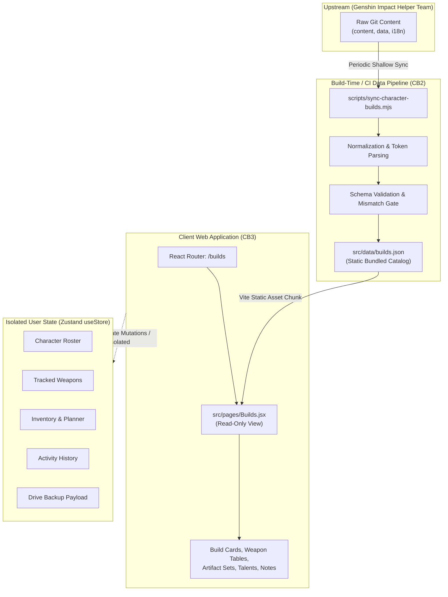
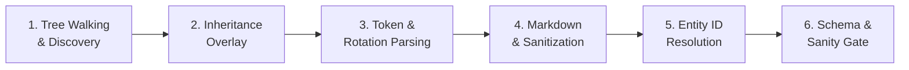

# CB1: Data Architecture & Normalization Specification

**Repository:** `travelers-toolkit`  
**Feature:** Character Builds Catalog  
**Milestone:** CB1 — Architecture Only  
**Target Delivery:** Milestone CB2 (Data Pipeline) & Milestone CB3 (UI Integration)  
**Architect:** Antigravity (DeepMind)  

---

## 1. Architectural Principles & Isolation Boundaries

The Character Builds feature restores the classic spreadsheet build recommendations within Traveler's Toolkit's modern web application.



### 1.1 Non-Negotiable Isolation Guarantees

1. **Pure Read-Only Reference Model:** The builds catalog is an editorial reference guide. Loading, filtering, or viewing recommendations never mutates user state.
2. **Persistence Schema Independence:** The Zustand persistent store (`STORE_NAME = 'travelers-toolkit-store'`, `STORE_VERSION = 8`) remains completely unmodified. No build-related slices are added to `partializeStore`.
3. **No Impact on User Progression:** Character roster progression, assigned weapons, target levels, and skill priorities are strictly isolated from the build catalog.
4. **No Impact on HoYoLAB Synchronization:** Character and weapon reconciliation routines (`hoyolabSyncApply.js`, `hoyolabCharacterReconciliation.js`) do not interact with build data.
5. **No Impact on Activity History:** Browsing build recommendations records zero activity logs into `src/activity`.
6. **No Impact on Cloud Backups:** Google Drive backup payloads (`getBackupPayload()`) and JSON export/import utilities remain untouched.
7. **Zero Client-Side GitHub Requests:** The browser client never issues HTTP requests to the upstream repository or the GitHub REST API. Build data is bundled as a static build asset (`src/data/builds.json`).

---

## 2. Normalized Recommendation Schema

The normalized data model preserves all upstream editorial nuance without artificial flattening. Sequential numbered ranks are preserved, equivalent weapons/sets within the same rank are maintained as sibling items, refinement ranges (`"3+"`, `"3-5"`) are preserved as strings or integers, and `choose: true` / `choices` pool semantics remain intact.

### 2.1 TypeScript Schema Definition

```typescript
/**
 * Canonical Root Character Builds Catalog
 */
export interface BuildCatalog {
  schemaVersion: 1;
  source: BuildSourceMetadata;
  characters: CharacterBuildEntry[];
}

/**
 * Provenance & Upstream Synchronization Metadata
 */
export interface BuildSourceMetadata {
  providerId: 'genshin-impact-helper-team';
  providerName: 'Genshin Impact Helper Team';
  upstreamRepository: 'https://github.com/Genshin-Impact-Helper-Team/genshin-builds';
  upstreamCommitSha: string;
  upstreamBranch: string;
  synchronizedAt: string; // ISO 8601 UTC timestamp
  licenseNotice: string;
  attributionUrl: string;
  totalCharacters: number;
  totalRoles: number;
}

/**
 * Character Entry Containing All Associated Role Builds
 */
export interface CharacterBuildEntry {
  characterId: string; // Toolkit canonical ID (e.g., "RaidenShogun", "TravelerAnemo")
  sourceSlug: string; // Upstream folder slug (e.g., "shogun-raiden", "traveler")
  publicSlug: string; // Upstream public slug (e.g., "shogun-raiden", "anemo-traveler")
  name: string; // English localized display name (e.g., "Raiden Shogun")
  element: 'Anemo' | 'Cryo' | 'Dendro' | 'Electro' | 'Geo' | 'Hydro' | 'Pyro';
  rarity: 4 | 5;
  weaponType: 'Sword' | 'Claymore' | 'Polearm' | 'Bow' | 'Catalyst';
  versionReleased: string;
  lastUpdated: string;
  isWip: boolean;
  builds: BuildRole[];
}

/**
 * Specific Role Build (e.g., Sub-DPS, Main DPS, Support)
 */
export interface BuildRole {
  buildId: string; // Composite unique key: `${characterId}:${roleSlug}`
  roleSlug: string; // Upstream role directory slug (e.g., "melt-DPS", "support")
  displayName: string; // Localized role name (e.g., "Melt DPS", "Off-Field Support")
  isBest: boolean; // Flag indicating top-tier recommendation
  reviewedVersion: string; // Version build was last updated (e.g., "7.0", "6.7 / Luna VIII")
  isWip: boolean; // True if build is flagged as WIP in last_updated
  status: 'available' | 'wip' | 'outdated' | 'invalid'; // Distinct lifecycle state
  weapons: WeaponsSection;
  artifacts: ArtifactsSection;
  talents: TalentsSection;
  notes: BuildEditorialNote[];
  gameplayTips: GameplayTip[];
  calculationCredits: CalculationCredit[];
}

/**
 * Weapons Recommendation Section
 */
export interface WeaponsSection {
  rankedGroups: WeaponRankGroup[];
  conditional: WeaponItem[];
  sectionNotes: string[]; // Rendered HTML notes for the weapons section
}

export interface WeaponRankGroup {
  rank: number; // 1-indexed display ranking
  items: WeaponItem[]; // Siblings in the same rank are equivalent (rendered with ≈)
}

export interface WeaponItem {
  sourceWeaponId: string; // Stable upstream weapon identifier (e.g., "staff-of-homa", "exaiphanes-blade")
  toolkitWeaponId: string | null; // Canonical Toolkit ID (e.g., "StaffOfHoma"), or null if unmapped
  name: string; // Localized weapon name (from Toolkit or upstream English dictionary)
  rarity: number; // 1 to 5 stars
  refinement: number | string | null; // e.g., 5, 1, "3+", "4+", "3-5"
  note: string | null; // Rendered HTML item note
  isToolkitItem: boolean; // True if mapped to Toolkit's canonical catalog; false if source-only recommendation
}

/**
 * Artifact Recommendations Section
 */
export interface ArtifactsSection {
  rankedGroups: ArtifactRankGroup[];
  conditional: ArtifactCombinationGroup[];
  mainStats: ArtifactMainStats;
  substats: ArtifactSubstatsSection;
  sectionNotes: string[];
}

export interface ArtifactRankGroup {
  rank: number; // 1-indexed display ranking
  groups: ArtifactCombinationGroup[]; // First group is primary; subsequent groups render with ≈
}

export interface ArtifactCombinationGroup {
  chooseTwo?: boolean; // When true, pick any two 2-piece bonuses from items
  items?: ArtifactItem[];
  choices?: ArtifactChoicePool[]; // Array of choose-one pools for 2p/2p combinations
}

export interface ArtifactChoicePool {
  label?: string; // Optional pool label
  items: ArtifactItem[];
}

export interface ArtifactItem {
  sourceSetId: string; // Stable upstream set ID or pseudo-set ID (e.g., "emblem-of-severed-fate", "atk-set")
  toolkitSetId: string | null; // Canonical Toolkit set ID, or null if unmapped or pseudo-set
  name: string; // Localized set name (e.g., "Emblem of Severed Fate", "+18% ATK set")
  pieces: 2 | 4;
  note: string | null; // Rendered HTML item note
  isToolkitItem: boolean; // True if mapped to Toolkit canonical artifact catalog; false if source-only or pseudo-set
  isPseudoSet: boolean; // True if item refers to a stat pseudo-set (e.g., atk-set)
  pseudoStatTag?: string; // Tag key if pseudo-set (e.g., "atk-set", "em-set")
}

export interface ArtifactMainStats {
  sands: StatOption[];
  goblet: StatOption[];
  circlet: StatOption[];
  sectionNotes: string[];
}

export interface StatOption {
  statKey: string; // Canonical stat key (e.g., "er", "atk%", "pyro-dmg", "cr")
  name: string; // Localized display name (e.g., "Energy Recharge", "Pyro DMG Bonus")
  note: string | null; // Rendered HTML note attached to this stat option
}

export interface ArtifactSubstatsSection {
  priorityGroups: SubstatPriorityGroup[];
  sectionNotes: string[];
}

export interface SubstatPriorityGroup {
  rank: number; // 1-indexed priority ranking
  items: StatOption[]; // Multiple items in one group are co-equal priority
}

/**
 * Talents Recommendation Section
 */
export interface TalentsSection {
  priorityGroups: TalentPriorityGroup[];
  sectionNotes: string[];
}

export interface TalentPriorityGroup {
  rank: number;
  isApproximate: boolean; // When true, separated from previous rank by ≈ instead of >
  items: TalentItem[]; // Multiple items in one rank are equal (=)
}

export interface TalentItem {
  talentKey: 'burst' | 'skill' | 'na';
  name: string; // Localized name (e.g., "Elemental Burst", "Elemental Skill")
  note: string | null;
}

/**
 * Editorial Notes & Gameplay Guidance
 */
export interface BuildEditorialNote {
  rawMarkdown: string;
  renderedHtml: string;
}

export interface GameplayTip {
  title: string;
  rawContentMarkdown: string;
  renderedHtml: string;
}

export interface CalculationCredit {
  category: 'global' | 'weapon' | 'artifact' | 'talent';
  author: string;
  link: string; // Verified HTTPS URL
  detail?: string; // Rendered HTML detail text
}
```

---

## 3. Source Normalization Rules & Pipeline

The synchronization pipeline executes a deterministic 6-phase normalization sequence:



### Phase 1: Content Discovery & Tree Walking
- Traverses `src/content/<element>/<rarity>/<character>/`.
- Bypasses internal non-character folders (`site/`).
- Extracts `<character>/metadata.json` for baseline weapon type, release version, and last updated version.
- Scans immediate child directories to detect role build folders (`<character>/<role>/`).

### Phase 2: Inheritance Overlay & Fallback Resolution
- Evaluates the 6 recommendation files for each role:
  1. `weapons.json`
  2. `artifacts-sets.json`
  3. `artifacts-mainstats.json`
  4. `artifacts-substats.json`
  5. `talents.json`
  6. `build-notes.json`
- **Inheritance Rule:** If `<character>/<role>/<file>.json` exists, it is loaded. If absent, the normalizer checks `<character>/<file>.json`. If present at the character root, that file is inherited as the default.
- If neither exists, optional files default to empty collections (`[]`), while required files trigger a warning.

### Phase 3: Inline Reference Tokens & Rotation Markers
- **Token Pattern:** `\[\[(?:([a-z]+):)?([^\]|]+)(?:\|([^\]]+))?\]\]`
  - Replaces token with localized display text from canonical dictionaries:
    - `[[character:furina]]` → `"Furina"`
    - `[[weapon:staff-of-homa]]` → `"Staff of Homa"`
    - `[[set:viridescent-venerer]]` → `"Viridescent Venerer"`
    - `[[stat:er]]` → `"Energy Recharge"`
    - `[[element:pyro]]` → `"Pyro"`
    - `[[ability:burst]]` → `"Elemental Burst"`
    - `[[weapon:the-catch|The Catch]]` → `"The Catch"` (explicit label preserved)
- **Robustness Against Typo Edge Cases:**
  - Upstream contains typos (`[[abillity:...]]`, `[[elemento:...]]`, and untagged `[[furina]]`).
  - Normalizer maps misspelled category keys to valid categories (`abillity` → `ability`, `elemento` → `element`).
  - Untagged tokens (`[[id]]`) undergo cascading category lookup (character → weapon → set → stat → ability).
- **Rotation Notation:**
  - Pattern: `\{rot:([^}]+)\}`
  - Transformed into semantic badge markup: `<span class="tt-rotation-badge" data-rotation="$1">$1</span>`.
  - In UI, clicking or hovering this badge displays the rotation legend (N = Normal, E = Skill, Q = Burst, C = Charged Attack).

### Phase 4: Markdown Normalization & Security Sanitization
- Editorial notes and gameplay tips are parsed using `marked`.
- Output HTML is processed through a strict sanitizer (e.g., `DOMPurify` / `sanitize-html`):
  - **Allowed Tags:** `p`, `span`, `strong`, `em`, `b`, `i`, `ul`, `ol`, `li`, `code`, `a`.
  - **Allowed Attributes:** `href` on `a` tags (only `https:` protocol allowed; `rel="noopener noreferrer"` and `target="_blank"` forced).
  - **Forbidden Tags:** `script`, `iframe`, `object`, `embed`, `form`, `input`, `style`, `svg`, `img`.

### Phase 5: Entity ID Resolution & Mapping
- **Characters:**
  - Traveler elements (`anemo-traveler`, `geo-traveler`, etc.) map deterministically to `TravelerAnemo`, `TravelerGeo`, `TravelerElectro`, `TravelerDendro`, `TravelerHydro`, `TravelerPyro`, `TravelerCryo`.
  - Standard characters map via slug normalization and translation lookup (`shogun-raiden` maps via `Raiden Shogun` → `RaidenShogun`).
- **Weapons:**
  - Shorthand aliases (`pjws`, `homa`, `widsith`, `ttds`) resolved via `translation-aliases.json`.
  - Weapon slugs mapped against Toolkit's canonical `src/data/weapons.json`.
  - Mapped weapons receive `toolkitWeaponId: "CanonicalId"` and `isToolkitItem: true`.
  - Unmapped weapons (e.g., `exaiphanes-blade`) retain `sourceWeaponId: "exaiphanes-blade"`, set `toolkitWeaponId: null`, and `isToolkitItem: false`. Their display name is resolved via upstream English i18n (`enWeapons[id]`).
  - **Zero Synthetic Entities:** The normalizer never injects fictional entries into Toolkit's curated `src/data/weapons.json`.
- **Artifacts:**
  - Aliases (`vv`, `noblesse`, `MH`, `emblem`) resolved via `translation-aliases.json`.
  - Real artifact sets mapped against Toolkit's canonical artifact catalog (`toolkitSetId: "SetId"`, `isToolkitItem: true`). Unmapped real sets retain `sourceSetId`, `toolkitSetId: null`, and `isToolkitItem: false`.
  - Pseudo-sets (`atk-set`, `em-set`, `er-set`, etc.) flagged as `isPseudoSet: true`, `toolkitSetId: null`, and `isToolkitItem: false`, storing their category tag. They are never treated as equipable artifact sets.

### Phase 6: Schema Validation & Integrity Gate
- Normalized JSON is validated against Zod schema definitions.
- Failure of any core assertion (e.g., character count < 129, malformed JSON, unparseable credit link) aborts the sync and retains the previous valid catalog snapshot.

---

## 4. Mapping Architecture & Artifact Catalog Independence

### 4.1 Canonical Mapping Tables

To ensure determinism and eliminate hardcoded ad-hoc logic, CB2 will maintain four version-controlled mapping lookup files:

| Mapping File | Purpose | Example Entry |
| :--- | :--- | :--- |
| `src/data/mappings/characterMap.json` | Upstream public slugs → Toolkit character IDs | `"anemo-traveler": "TravelerAnemo"`, `"shogun-raiden": "RaidenShogun"` |
| `src/data/mappings/weaponMap.json` | Upstream weapon slugs → Toolkit weapon IDs | `"staff-of-homa": "StaffOfHoma"`, `"the-catch": "TheCatch"` |
| `src/data/mappings/artifactSetMap.json` | Upstream set slugs → Toolkit artifact set IDs | `"viridescent-venerer": "ViridescentVenerer"` |
| `src/data/mappings/pseudoSetMap.json` | Upstream pseudo-set slugs → Display labels & tag filters | `"atk-set": { "label": "+18% ATK set", "tag": "atk-set" }` |

### 4.2 Standalone Canonical Artifact Catalog (`src/data/artifacts.json`)

The user manually maintains Toolkit's canonical game datasets (`characters.json`, `traveler.json`, `weapons.json`). In alignment with this pattern, `src/data/artifacts.json` is a user-maintained, curated dataset of playable Genshin artifact sets.

**Catalog Independence Rules:**
1. **No Automated Overwrites:** The upstream build recommendation synchronizer treats `src/data/artifacts.json` as strictly read-only. The sync script **must never automatically mutate, expand, or overwrite this file**.
2. **Recommendation References vs Game Entities:** Recommendations reference sets via `sourceSetId`. If an upstream recommendation cites an artifact set not yet present in Toolkit's canonical catalog, it is preserved as a source-only recommendation (`toolkitSetId: null`, `isToolkitItem: false`), without forcing synthetic creation in the game database.
3. **Pseudo-Sets are Non-Equipable:** Abstract categories like `atk-set` represent stat-bonus archetypes, not equipable game items. They are excluded from `artifacts.json` and categorized strictly as recommendation helper tags.

#### Schema of Toolkit Canonical Artifact Registry (`src/data/artifacts.json`):
```json
[
  {
    "id": "ViridescentVenerer",
    "name": "Viridescent Venerer",
    "rarity": 5,
    "tags": ["anemo-set", "elemental-res"],
    "bonuses": {
      "2p": "Anemo DMG Bonus +15%",
      "4p": "Increases Swirl DMG by 60%. Decreases opponent's Elemental RES to the element infused in the Swirl by 40% for 10s."
    },
    "icon": "/artifacts/ViridescentVenerer.png"
  }
]
```

---

## 5. Client Integration Boundaries (CB3)

### 5.1 Route & Lazy Chunk Integration (`src/App.jsx`)

The Character Builds page will be mounted as a top-level route in `src/App.jsx`:

```jsx
const Builds = lazy(() => import('./pages/Builds'));

// Inside <Routes>:
<Route path="builds" element={withSuspense(Builds)} />
<Route path="builds/:characterId" element={withSuspense(Builds)} />
```

### 5.2 Navigation Placement (`src/layouts/AppLayout.jsx`)

In `AppLayout.jsx`, `Builds` will be added to the navigation sections under **Progression** (or a dedicated **Reference** section):

```javascript
{
  id: 'progression',
  label: 'Progression',
  items: [
    { to: '/', label: 'Dashboard', icon: '/Dashboard.png', id: 'nav-dashboard' },
    { to: '/characters', label: 'Characters', icon: '/Characters.png', id: 'nav-characters' },
    { to: '/builds', label: 'Character Builds', icon: '📖', id: 'nav-builds' },
    { to: '/weapons', label: 'Weapons', icon: '/Weapons.png', id: 'nav-weapons' },
    { to: '/planner', label: 'Planner', icon: '/Planner.png', id: 'nav-planner' },
    { to: '/inventory', label: 'Inventory', icon: '/Inventory.png', id: 'nav-inventory' },
  ],
}
```

### 5.3 UI Component Hierarchy

```text
src/pages/Builds.jsx
├── BuildsOverview.jsx (Character selection grid with Element & Weapon filters)
└── CharacterBuildDetail.jsx (Selected character build sheet)
    ├── BuildHeader.jsx (Portrait, element badge, version updated tag, role tabs)
    ├── WeaponsRecommendationCard.jsx (Ranked weapon groups, refinements, item notes)
    ├── ArtifactSetsCard.jsx (Ranked sets, Choose-Two tags, 2p/2p pools, conditional sets)
    ├── StatsPriorityCard.jsx (Sands, Goblet, Circlet main stats + Substat priority tiers)
    ├── TalentPriorityCard.jsx (Talent sequence with '>' and '≈' connectors)
    ├── BuildNotesAccordion.jsx (Editorial notes, rotation markers, gameplay tips)
    └── AttributionFooter.jsx (Helper Team attribution, theorycrafter credit links)
```

---

## 6. Implementation Sequence & Roadmap

| Milestone | Scope | Deliverables |
| :--- | :--- | :--- |
| **CB1** *(Current)* | Source Audit, Architecture, & Sync Policy | Documentation only: `CB1-source-audit.md`, `CB1-architecture.md`, `CB1-sync-and-attribution-policy.md`. |
| **CB2** | Data Pipeline, Normalizer, & Artifact Catalog Setup | Node.js sync script (`scripts/sync-character-builds.mjs`), user-curated canonical `src/data/artifacts.json`, static mapping tables, schema validation suite (`tests/builds.test.js`), and generated static `src/data/builds.json`. *(Canonical game datasets remain strictly protected from automated mutation).* |
| **CB3** | UI Implementation & Client Routing | `/builds` route, character selector, role tab views, equipment ranking components, rotation popovers, attribution footers, and mobile responsiveness. |
| **CB4** *(Deferred)* | Optional Personalization | Optional toggle to highlight weapons owned in user's `trackedWeapons` inventory. Disabled by default. |

> [!IMPORTANT]
> **Milestone Boundary:** No UI code, synchronization scripts, or persistent store modifications may be executed until CB1 is formally approved.
