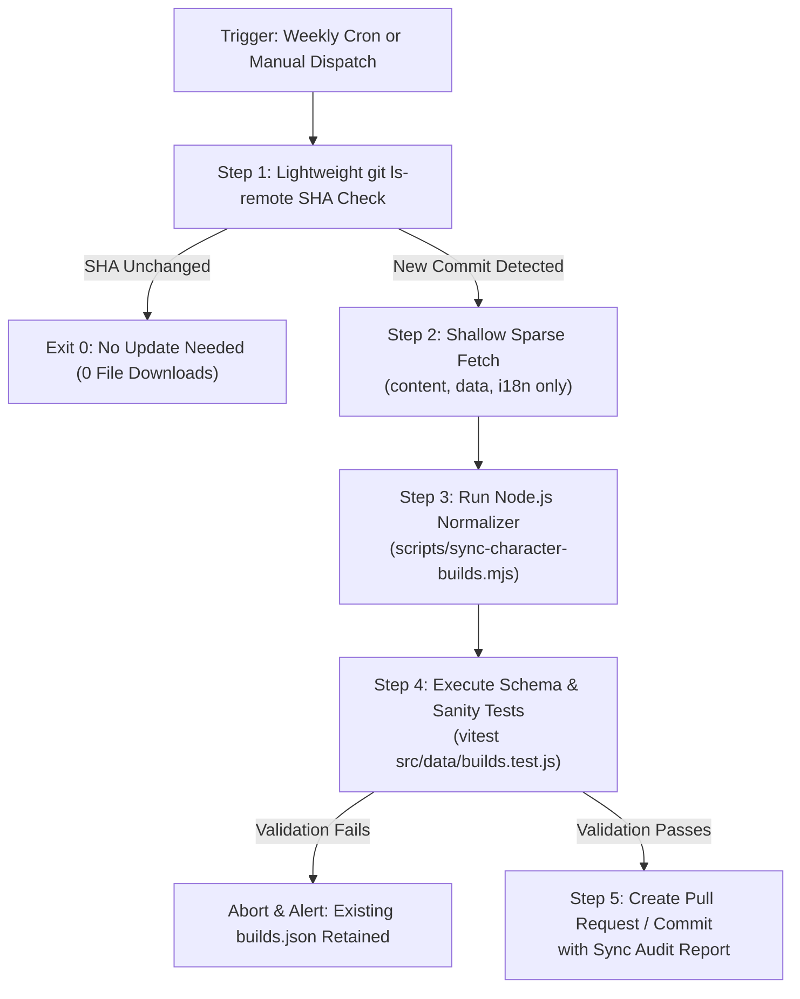
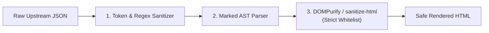

# CB1: Upstream Synchronization, Attribution & Content Safety Policy

**Repository:** `travelers-toolkit`  
**Feature:** Character Builds Catalog  
**Milestone:** CB1 — Architecture Only  
**Target Delivery:** Milestone CB2 (Data Pipeline) & Milestone CB3 (UI Integration)  
**Author:** Antigravity (DeepMind)  

---

## 1. Guiding Principles & Community Respect

Traveler's Toolkit incorporates character build recommendations through explicit written authorization granted by the **Genshin Impact Helper Team**. 

Because the Helper Team maintains a public community repository, our automated synchronization architecture is engineered under a strict **Zero-Impact Policy**:

1. **No Browser-Side Traffic:** End users of Traveler's Toolkit will never initiate network requests to the Helper Team's repository or to GitHub's REST API. All build data is synchronized upstream during offline maintenance or CI workflows and bundled statically into the application.
2. **Minimal Upstream Footprint:** Upstream checks occur at low frequency, inspect lightweight revision hashes before retrieving files, and bypass all binary assets.
3. **Strictly Read-Only:** The synchronization process never creates issues, comments, pull requests, or commits in the upstream repository.
4. **Attribution & Intellectual Integrity:** The Helper Team's editorial authority and copyright over their recommendations are visibly credited throughout the interface without misrepresenting third-party data under Toolkit's MIT software license.

---

## 2. 16-Point Safe Upstream Synchronization Specification

The future synchronization runner (to be implemented in **CB2**) must adhere strictly to the following 16 operational safeguards:

| # | Safe Access Principle | Technical Implementation Rule |
| :---: | :--- | :--- |
| **1** | **Zero Browser-Side Requests** | The client web application loads recommendations strictly from local static JSON (`src/data/builds.json`). No `fetch()` or `octokit` calls to `api.github.com` or `raw.githubusercontent.com` are permitted in frontend code. |
| **2** | **Bounded Check Frequency** | Automated revision checks are scheduled **no more than once every 24 hours** (e.g., weekly or bi-weekly cron). Accidental rapid polling is prohibited. |
| **3** | **SHA-First Revision Check** | Before downloading content, the runner performs a lightweight check of the upstream HEAD SHA (via `git ls-remote https://github.com/Genshin-Impact-Helper-Team/genshin-builds main` or GitHub API). If the remote commit SHA matches `source.upstreamCommitSha` in `builds.json`, the job terminates immediately (in ~2 seconds) with **zero file downloads**. This gate applies identically to both scheduled cron jobs and manual maintainer dispatches. |
| **4** | **Content-Only Retrieval** | When an update is detected, retrieval is restricted strictly to content and translation files (`src/content/`, `src/data/`, `src/i18n/`, `schemas/`). Assets and website code are completely excluded. |
| **5** | **Immutable Revision Pinning** | Content is imported from a specific, immutable Git commit SHA. The SHA is validated before extraction and recorded in the catalog header. |
| **6** | **Strict Asset & History Exclusion** | The runner bypasses `src/assets/character-assets/` (WebP images), documentation, test suites, site layouts, and Git history (`--depth 1` or archive tarball). |
| **7** | **Sequential, Non-Parallel Processing** | File ingestion and normalization execute sequentially within a single process. Concurrency flooding against GitHub is prohibited. |
| **8** | **Bounded Retries with Backoff** | If a network connection fails, the runner allows a maximum of **3 retry attempts** using exponential backoff (e.g., 5s, 15s, 45s). |
| **9** | **Rate-Limit Compliance** | The runner monitors HTTP response headers (`X-RateLimit-Remaining`, `X-RateLimit-Reset`, `Retry-After`). Upon receiving `403` or `429`, the runner halts immediately and defers execution until the reset window opens. |
| **10** | **Concurrency Lock Guard** | GitHub Actions workflows enforce a concurrency group (`concurrency: sync-builds-lock`), terminating redundant runs and preventing simultaneous executions. |
| **11** | **Sandboxed Script Execution & Dataset Protection** | The runner executes only Toolkit's own normalization code. It **never** invokes upstream npm scripts (`npm install`, `npm run build`, `node scripts/...`). Furthermore, the sync runner **never writes to or mutates Toolkit's canonical game datasets** (`characters.json`, `traveler.json`, `weapons.json`, `artifacts.json`); it outputs only `src/data/builds.json`. |
| **12** | **Pure Read-Only Access** | The sync process connects anonymously or via standard read-only tokens. It never creates, modifies, or deletes upstream branches, tags, issues, or pull requests. |
| **13** | **Zero Write Credentials** | Neither local environments nor CI workflows may configure GitHub tokens possessing write permissions to the upstream repository. |
| **14** | **Atomic Swap & Fallback Preservation**| Data generation writes to a temporary staging file (`src/data/builds.tmp.json`). If validation fails at any point, the staging file is discarded, leaving the existing catalog intact. |
| **15** | **Audit Logging & Telemetry** | Every execution records structured metadata: upstream SHA, timestamp, character counts, role counts, mapping warnings, and duration. |
| **16** | **Maintainer Manual Trigger Safeguards** | Manual dispatches (`workflow_dispatch`) require maintainer approval, pass through the SHA-first revision check, and enforce a 15-minute cooldown guard to prevent accidental repeated downloads. |

---

## 3. Scheduling Architecture Evaluation

### 3.1 Comparison: GitHub Actions vs. Vercel Build Integration

| Evaluation Criterion | GitHub Actions Scheduled Workflow *(Recommended)* | Vercel Deployment Build Step *(Rejected)* |
| :--- | :--- | :--- |
| **Execution Trigger** | Dedicated cron schedule (e.g., weekly) or manual maintainer dispatch. | Triggers on **every** commit and website preview deployment. |
| **Rate Limit Impact** | Predictable, strictly bounded (1 check per week = negligible). | High risk of burst traffic during active development sprints. |
| **Build Stability** | Independent of website builds. If upstream fails, site deployments continue uninterrupted. | Upstream outages or rate limits would break production site builds. |
| **Maintainer Oversight** | Generates an auditable Git commit or PR with diffs and validation summaries before deployment. | Silent, automated deployment without human inspection of data diffs. |
| **Execution Overhead** | Runs on free GitHub Actions minutes (~45 seconds per run). | Consumes Vercel build execution time and serverless resources. |

### 3.2 Recommended Sync Architecture: GitHub Actions

For a small, non-commercial open-source project, the most robust, maintainable architecture is a **GitHub Actions workflow** with manual and weekly cron triggers:



> [!WARNING]
> **CB1 Scope Rule:** No GitHub Actions workflow may be created or activated in Milestone CB1. The workflow will be implemented in Milestone CB2.

### 3.3 Publication & Deployment Strategy Evaluation

To serve the generated recommendation catalog to users, two primary distribution strategies were evaluated:

| Architectural Criterion | Option A: Repository-Tracked Static Catalog (`src/data/builds.json`) *(Recommended)* | Option B: Separately Deployed / External Asset (CDN / External Repo) *(Rejected)* |
| :--- | :--- | :--- |
| **Operational Simplicity** | **Highest.** Builds into standard Vite bundle chunks. Zero additional infrastructure, buckets, or hosting accounts to configure or monitor. | **Low.** Requires external cloud storage (S3/Cloudflare R2/separate GitHub repo), API tokens, and CORS configuration. |
| **Runtime Reliability** | **100% Reliable.** Zero client-side network dependencies. Never suffers from external CDN downtime, DNS outages, or CORS failures. | **Fragile.** If external storage or CDN is unreachable or rate-limited, the builds feature breaks completely for all users. |
| **Performance & Latency** | **Instantaneous.** Loaded as a pre-bundled static asset chunk via React lazy import. Cached automatically by browser service workers. | **Network Latency.** Requires an extra client-side asynchronous HTTP fetch before the user can view recommendations. |
| **Auditability & Review** | **Full Git History.** Every synchronized change produces a clear, auditable Git diff that the project owner reviews before merging. | **Opaque.** Data updates occur out-of-band without version-controlled review alongside application code. |
| **Licensing Compliance** | **Clean & Compliant.** File header carries explicit third-party copyright notice and attribution metadata, separating editorial content from MIT code. | **Equivalent.** Can also carry notice, but offers no legal advantage over Option A under the permission granted. |

#### Architectural Recommendation: Option A (Repository-Tracked Static Catalog)
Option A is recommended as the simplest, most technically sound solution for Traveler's Toolkit. It operates entirely within the scope of the permission granted by the Helper Team to "retrieve, normalize, cache, periodically synchronize and display their build recommendations."

**Strict Publication Safeguards under Option A:**
1. **Explicit Third-Party Notice:** `src/data/builds.json` explicitly states:
   `"licenseNotice": "Character build recommendations and editorial notes are Copyright © 2026 Genshin Impact Helper Team contributors. Used with explicit permission. Not licensed under MIT."`
2. **Clear Licensing Separation:** Toolkit's root `LICENSE` file remains MIT, governing our application code only. Third-party recommendation data is isolated in `src/data/builds.json`.
3. **No Unnecessary Redistribution:** Only normalized text and recommendation data are included. Upstream website source code, Astro layouts, and character WebP images are **strictly excluded**.
4. **Preserved Provenance:** Every catalog file records the exact upstream commit SHA and synchronization timestamp.
5. **Private Records Kept Confidential:** The private email authorization from the Helper Team is strictly confidential and will **never** be committed to the public repository.

---

## 4. Content Safety & Security Engineering

Editorial recommendations from external sources must be treated as untrusted input. The ingestion pipeline implements defenses against cross-site scripting (XSS), malicious links, and prototype pollution:



### 4.1 Strict HTML Whitelist & XSS Prevention
- Raw Markdown from `build-notes.json` (`notes[]`, `tips[]`) is rendered via `marked` and sanitized before being written into `builds.json`.
- **Allowed Elements:** `p`, `span`, `strong`, `em`, `b`, `i`, `ul`, `ol`, `li`, `code`, `a`.
- **Allowed Attributes:** `href`, `title`, `class`, `data-*`.
- **Disallowed Elements:** `script`, `iframe`, `object`, `embed`, `form`, `input`, `style`, `svg`, `img`. Any HTML tags inside source text are stripped or escaped.

### 4.2 Hyperlink & Protocol Validation
- Upstream calculation credits contain external URLs (`link: "https://..."`).
- The validator enforces:
  1. **Protocol:** Must strictly be `https:`. Any `http:`, `javascript:`, `data:`, or relative URIs trigger immediate rejection.
  2. **Security Attributes:** In UI rendering, all external links must include `target="_blank"` and `rel="noopener noreferrer"`.

### 4.3 Safe Rotation Notation
- Rotation markers (`{rot:...}`) are parsed into structured data objects rather than dynamic executable HTML.
- Badges render with localized legend tooltips (e.g., `N = Normal Attack`, `E = Elemental Skill`, `Q = Elemental Burst`).

---

## 5. Licensing, Attribution & Intellectual Property

### 5.1 The Dual-Licensing Boundary

Traveler's Toolkit and the Genshin Impact Helper Team's repository operate under fundamentally different licensing terms:

```text
┌────────────────────────────────────────────────────────────────────────┐
│ TRAVELER'S TOOLKIT CODEBASE                                            │
│ License: MIT License (Permissive open-source software license)        │
│ Applies to: React components, hooks, calculation algorithms, CSS, store │
└────────────────────────────────────┬───────────────────────────────────┘
                                     │ Bundles & Displays
┌────────────────────────────────────▼───────────────────────────────────┐
│ THIRD-PARTY EDITORIAL CONTENT (Genshin Impact Helper Team)             │
│ License: Copyright © 2026 Helper Team Contributors. All rights reserved.│
│ Sublicensing: NOT relicensed under MIT. Distributed with permission.   │
│ Applies to: Build recommendations, weapon rankings, artifact notes     │
└────────────────────────────────────┬───────────────────────────────────┘
                                     │ References
┌────────────────────────────────────▼───────────────────────────────────┐
│ GAME ASSETS & INTELLECTUAL PROPERTY (HoYoverse / Cognosphere)         │
│ License: Copyright © COGNOSPHERE PTE. LTD.                             │
│ Applies to: Character names, weapon names, artwork, icons, base stats   │
└────────────────────────────────────────────────────────────────────────┘
```

### 5.2 Preservation of Editorial Rights
- Distributing `src/data/builds.json` does **not** grant downstream consumers the right to relicense the recommendation text under the MIT license.
- The `src/data/builds.json` header explicitly states:
  ```json
  "licenseNotice": "Character build recommendations and editorial notes are Copyright © 2026 Genshin Impact Helper Team contributors. Used with explicit permission. Not licensed under MIT."
  ```
- Toolkit's root `LICENSE` file remains MIT, governing our application code only.

### 5.3 User-Facing Attribution Requirements
In the web application, the Character Builds catalog must display clear attribution:
1. **Catalog Header / Footer Banner:**
   > *"Character build recommendations, weapon rankings, and equipment notes are curated by the **Genshin Impact Helper Team** and used with permission. Visit their [official repository](https://github.com/Genshin-Impact-Helper-Team/genshin-builds) for original guides and feedback."*
2. **Character Guide Deep-Links:** Each character detail card will link back to the Helper Team's specific character guide page.
3. **Theorycrafting Calculation Credits:** Authors of external mathematical models cited in `calculationCredits` (e.g., KeqingMains, individual TC contributors) are credited alongside links to their sheets.

### 5.4 Privacy of Authorization Records
The private email correspondence granting permission to integrate their recommendations contains private contact details. In accordance with community standards:
- **The permission email must NEVER be committed to the public repository.**
- Verification inquiries are directed to the project maintainer or to the Helper Team's public feedback channels.

---

## 6. Comprehensive Validation Strategy (Test Matrix)

In Milestone **CB2**, an automated test suite (`tests/characterBuilds.test.js`) will validate the synchronized catalog before deployment:

| Category | Test Case | Expected Assertion |
| :--- | :--- | :--- |
| **Catalog Integrity** | Total Character Count | Exactly 129 characters present in catalog. |
| **Catalog Integrity** | Total Role Count | Exactly 184 roles present across characters. |
| **Identity Mapping** | Traveler Elements | All 7 Traveler elements map to `TravelerAnemo`..`TravelerCryo`. |
| **Identity Mapping** | Raiden Shogun Mapping | `shogun-raiden` maps to `RaidenShogun`. |
| **Identity Mapping** | Weapon Coverage | 100% of referenced weapons mapped to Toolkit IDs or preserved as source-only items (`toolkitWeaponId: null`, `isToolkitItem: false`). Zero synthetic entries added to canonical `weapons.json`. |
| **Catalog Independence** | Canonical Datasets | Sync pipeline performs 0 writes to `characters.json`, `traveler.json`, `weapons.json`, or `artifacts.json`. |
| **WIP Classification** | Lifecycle State | Build-level `last_updated` evaluated before character root; WIP builds flagged `isWip: true` and `status: 'wip'`. |
| **Inheritance Fallback**| Character Root Overlay | Roles without `weapons.json` (e.g. Sethos) inherit character-level weapons. |
| **Rank Fidelity** | Multi-Item Equivalence | Weapons sharing rank 1 maintain identical rank number and `items` sibling array. |
| **Rank Fidelity** | Approximate Priority | Talents with `approx: true` flagged with `isApproximate: true`. |
| **Artifact Fidelity** | Choose-Two Groups | Groups with `choose: true` preserved as `chooseTwo: true`. |
| **Artifact Fidelity** | Choice Pools | Groups with `choices` preserved as distinct choice pools. |
| **Artifact Fidelity** | Pseudo-Set Recognition | `atk-set`, `em-set`, etc. flagged as `isPseudoSet: true`. |
| **Stat Fidelity** | Main Stats Slots | Sands, Goblet, Circlet populated with valid stat options. |
| **Content Safety** | Script Tag Stripping | No `<script>`, `<iframe>`, or `javascript:` in rendered HTML. |
| **Content Safety** | Credit Link Validation | All calculation credit URLs strictly begin with `https://`. |
| **Sanity Gate** | Unchanged Revision | Runner exits with code 0 and 0 downloads if commit SHA matches. |
| **Fault Tolerance** | Malformed Upstream | Failed parsing or schema validation preserves existing `builds.json`. |
| **State Isolation** | Read-Only Boundary | Loading catalog modifies 0 keys in Zustand `useStore` or localStorage. |
