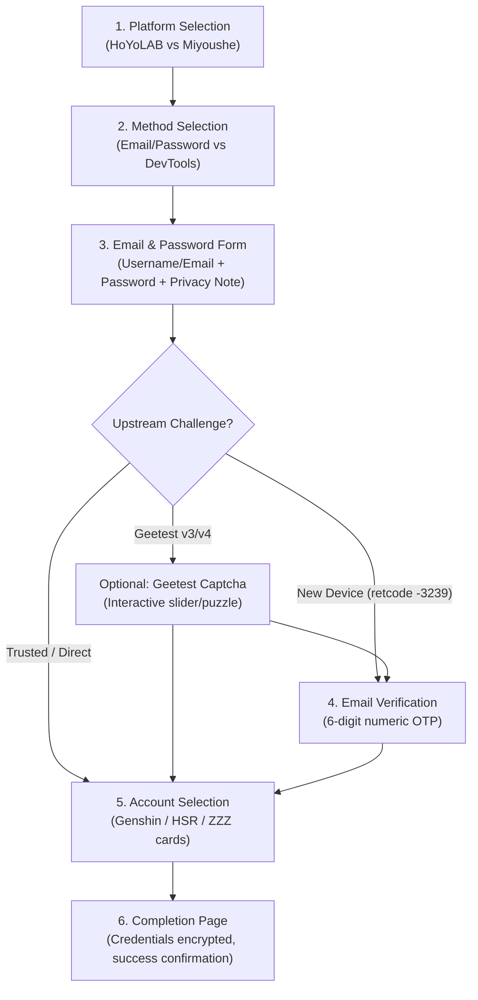

# HoYoLAB Email/Password Authentication Flow Feasibility Spike (Stage A2)

> **Document Status:** Complete Research & Feasibility Analysis
> **Repository:** `travelers-toolkit`
> **Committed Baseline:** `main` @ `ef45359`
> **Target Feasibility Classification:** **C — FEASIBLE BUT REQUIRES PROXY / DISTRIBUTED STATE INFRASTRUCTURE** (Production Serverless) / **B — FEASIBLE WITH SMALL BACKEND ADDITIONS** (Local Desktop / Self-Hosted)
> **Constraint Notice:** No production frontend or backend auth endpoints were modified in this stage. No real user credentials or session cookies were collected or stored.

---

## 1. Executive Summary

In Stage A, investigation concluded that overseas HoYoLAB Web Passport QR authentication is not supported by HoYoverse. However, analysis of current upstream **Hoyo Buddy** (`seriaati/hoyo-buddy` and `seriaati/hb-app`) reveals that its overseas HoYoLAB account onboarding flow relies on **Email & Password Authentication** using the HoYoLAB mobile app passport endpoints (`ma-passport`), backed by Python's `genshin==1.7.29` library.

The sequence comprises:
1. **Email & Password Submission:** Outbound call to HoYoverse `appLoginByPassword` using RSA-encrypted credentials.
2. **Conditional Challenges:** Handling either Geetest v3 (`SessionMMT`), Geetest v4 (`SessionMMTv4`), or Email 2FA OTP (`ActionTicket`).
3. **Session Finalization:** Token exchange (`getBySToken`) converting the app `stoken` into `ltoken_v2`, alongside `ltuid_v2`.
4. **Account Discovery:** Querying `binding/api/getUserGameRolesByCookie` to allow the user to select their Genshin Impact account UID.
5. **State Normalization:** Persisting only `ltuid_v2` and `ltoken_v2` in the existing `tt_hoyolab_session` Fernet cookie and immediately discarding all password and challenge state.

While technically functional and 100% compatible with Traveler's Toolkit's existing session architecture, **critical infrastructure constraints exist for production serverless deployments (Vercel)**. HoYoverse aggressively challenges or blocks datacenter IP ranges (AWS/Vercel egress), which led Hoyo Buddy to route all overseas login steps through a dedicated **residential proxy** (`CONFIG.residential_proxy`).

---

## 2. Screenshot-Observed UX Flow (Hoyo Buddy)

From live usage and inspection of `seriaati/hb-app`, the user onboarding experience flows through six distinct visual stages:



1. **Platform Selection:** User selects between **HoYoLAB** (Global/Overseas) and **Miyoushe** (China).
2. **Method Selection:** User chooses between **Email & Password** (automated) and **DevTools** (manual cookie paste).
3. **Email & Password Form:**
   - Inputs for Email/Username and Password (`autocomplete="username"`, `autocomplete="current-password"`).
   - Prominent security disclaimer stating that credentials are used solely to negotiate authentication with HoYoverse and are not stored.
   - Help links for console players and third-party social logins (Google/Apple/Facebook) explaining how to link an email in HoYoverse User Center.
4. **Optional Geetest Captcha:** Interactive slider/match puzzle modal if HoYo's risk engine triggers retcode `-3101`.
5. **Email Verification Modal / Page:**
   - 6-digit numeric OTP input field (`maxLength={6}`, `inputMode="numeric"`).
   - Displayed when logging in from a new/unrecognized `device_id` (retcode `-3239`).
6. **Account Selection Screen:**
   - Visual cards listing all discovered game accounts with game title, nickname, server name, UID, and Adventure Rank/level.
   - Multi-select capability (in Hoyo Buddy; Traveler's Toolkit only needs single Genshin account selection).
7. **Completion Screen:** Confirmation that connection succeeded and navigation back to dashboard.

---

## 3. Hoyo Buddy Upstream Implementation Analysis

Inspection of `seriaati/hoyo-buddy` (backend) and `seriaati/hb-app` (frontend) reveals the exact protocol implementation:

### 3.1 Backend Endpoints & Sequence
- **`POST /api/login/email-password?platform=hoyolab`**
  - Instantiates `ProxyGenshinClient(region=OVERSEAS, proxy_url=CONFIG.residential_proxy)`.
  - Generates or retrieves stable `device_id` from `hb_device_id` cookie.
  - Calls `client._app_login(email, password, device_id=device_id, device_name="Hoyo Buddy", device_model=version)`.
  - **Output branches:**
    - `SessionMMT` (Geetest v3): Stores Fernet-encrypted email and password in session; returns `{"next_step": "geetest", "gt_version": 3, "mmt": {...}}`.
    - `SessionMMTv4` (Geetest v4): Stores encrypted credentials; returns `{"next_step": "geetest", "gt_version": 4, "api_server": "gcaptcha4.captchami.com", "mmt": {...}}`.
    - `ActionTicket` (Email 2FA): Dispatches verification email via `client._send_verification_email(result)`; stores encrypted credentials + `action_ticket`; returns `{"next_step": "email_verify"}`.
    - `AppLoginResult`: Successful immediate login; stores Fernet-encrypted cookies in session; returns `{"next_step": "finish"}`.
- **`POST /api/login/geetest-callback`**
  - Receives challenge tokens (`geetest_challenge`, `geetest_validate`, `geetest_seccode` or v4 `lot_number`, `pass_token`, etc.).
  - Recreates `SessionMMTResult` or `SessionMMTv4Result`.
  - Re-invokes `client._app_login(decrypted_email, decrypted_password, ..., mmt_result=mmt_result)`.
- **`POST /api/login/email-verify`**
  - Receives 6-digit verification code.
  - Calls `client._verify_email(code, flow.action_ticket)`.
  - Re-invokes `client._app_login(decrypted_email, decrypted_password, ..., ticket=flow.action_ticket)`.
- **`GET /api/accounts/available`**
  - Exchanges `stoken` + `ltmid_v2` for `ltoken_v2` via `genshin.fetch_cookie_with_stoken_v2(cookies, token_types=[2, 4])`.
  - Calls `client.get_game_accounts()`.
  - Returns list of `AccountInfo(uid, nickname, game, server_name, level)`.
- **`POST /api/accounts/submit`**
  - Saves chosen accounts and final session credentials into persistent database.
  - Clears temporary login flow session state.

### 3.2 Hoyo Buddy Session Security Architecture
Inspection of `hoyo_buddy/api/session.py` and `hoyo_buddy/api/utils.py` demonstrates a three-layer session model:
1. **Outer Transport Layer:** Signed HttpOnly cookie (`hb_session`) managed by `SignedCookieSessionMiddleware` using `itsdangerous.URLSafeTimedSerializer`.
2. **Intermediate Flow Layer:** Sensitive intermediate login fields (`encrypted_email`, `encrypted_password`) are additionally Fernet-encrypted (`Fernet(CONFIG.fernet_key)`) inside the signed session dict, ensuring plaintext passwords never reside in raw cookie state.
3. **Persistent Cookie Layer:** Once authentication succeeds, the resulting HoYo session cookies (`encrypted_cookies`) are separately Fernet-encrypted before storage. Plaintext credentials are never exposed in logs or unencrypted cookies.

### 3.2 Frontend Architecture (`hb-app`)
- **Script Loading:** Dynamically injects official Geetest JavaScript SDKs into the DOM:
  - Geetest v3: `https://static.geetest.com/static/js/gt.0.5.0.js`
  - Geetest v4: `https://static.geetest.com/v4/gt4.js`
- **CSP Requirements:** Content-Security-Policy must allow script loading from `https://static.geetest.com` and network connections to `https://*.geetest.com` and `https://*.captchami.com`.
- **Flow State Management:** React router transitions based on `next_step` response field (`/geetest`, `/email-verify`, `/finish`).

---

## 4. `genshin==1.7.29` Internal Mechanism Deep-Dive

Traveler's Toolkit uses `genshin==1.7.29`. Inspection of the installed package in `backend/.venv` confirms that all necessary overseas app login primitives are native to this release without requiring any fork or version bump:

### 4.1 Method Signatures & Endpoints

| Method | Target HoYoverse URL | Payload / Security | Return Type |
|---|---|---|---|
| `_app_login` | `https://sg-public-api.hoyoverse.com/account/ma-passport/api/appLoginByPassword` | RSA-encrypted email & password with HoYo public key (`LOGIN_KEY_TYPE_1`), DS header, `x-rpc-device_id`, optional `x-rpc-aigis`, optional `x-rpc-verify` | `AppLoginResult` \| `SessionMMT` \| `SessionMMTv4` \| `ActionTicket` |
| `_send_verification_email` | `https://sg-public-api.hoyoverse.com/account/ma-verifier/api/createEmailCaptchaByActionTicket` | `action_type: "verify_for_component"`, `action_ticket: ticket.verify_str.ticket` | `None` (success) \| `SessionMMT` (captcha triggered) |
| `_verify_email` | `https://sg-public-api.hoyoverse.com/account/ma-verifier/api/verifyActionTicketPartly` | `action_ticket`, `email_captcha: code`, `verify_method: 2` | `None` (success) |
| `fetch_cookie_with_stoken_v2` | `https://sg-public-api.hoyoverse.com/account/ma-passport/token/getBySToken` | `dst_token_types: [2, 4]`, cookies: `stoken`, `ltmid_v2` (`mid`), DS header | `{"ltoken_v2": str, "cookie_token_v2": str}` |
| `get_game_accounts` | `https://sg-public-api.hoyoverse.com/binding/api/getUserGameRolesByCookie` | Authenticated cookies (`ltuid_v2`, `ltoken_v2`) | `Sequence[GenshinAccount]` |

### 4.2 Credential Protection in Transit
The password is **not** transmitted in plaintext to HoYoverse. In `genshin.utility.encrypt_credentials`:
```python
def encrypt_credentials(text: str, key_type: typing.Literal[1, 2]) -> str:
    public_key = rsa.PublicKey.load_pkcs1_openssl_pem(LOGIN_KEY_TYPE_1)
    crypto = rsa.encrypt(text.encode("utf-8"), public_key)
    return base64.b64encode(crypto).decode("utf-8")
```
The client library RSA-encrypts the credentials with HoYoverse's embedded RSA public key prior to sending the HTTPS request. Outbound traffic is therefore protected by **both TLS transport encryption and RSA application-layer encryption**.

---

## 5. End-to-End Data Path & Plaintext Password Exposure

To satisfy strict security and privacy standards, the exact physical lifecycle of the user's password must be traced:

```
[User Browser Input]
  │  (Plaintext in DOM memory / form state)
  â–¼
[HTTPS POST /api/hoyolab/auth/email-password]
  │  (TLS ciphertext in transit over the Internet)
  â–¼
[Traveler's Toolkit Backend (FastAPI)]
  │  (Plaintext in Python memory during request execution: Pydantic AuthPayload)
  ├────────────────────────────────────────────────────────────────────────┐
  │ [If immediate success]                                                 │ [If challenge triggered (Geetest/2FA)]
  │                                                                        │
  │ • RSA-encrypts with HoYo public key                                   │ • Fernet-encrypts {email, password, device_id}
  │ • HTTPS POST to HoYoverse                                             │ • Sets HttpOnly SameSite=Lax cookie (tt_hoyolab_flow_state)
  │ • Receives cookies; deletes local memory                              │ • Client solves challenge; POSTs callback
  │ • Normalizes ltuid/ltoken into tt_hoyolab_session                     │ • Backend decrypts Fernet cookie into memory
  │ • Zero password retention                                             │ • Retries _app_login; deletes flow cookie
  â–¼                                                                        â–¼
[HoYoverse Passport Endpoint (sg-public-api.hoyoverse.com)]
```

### Critical Security Guarantees:
1. **No Browser Storage:** Password is never written to `localStorage`, `sessionStorage`, or indexedDB.
2. **No Persistent Backend Storage:** Password is never written to SQLite, PostgreSQL, files, or persistent caches.
3. **No Logging:** Password, email, verification code, and session tokens are strictly excluded from all `logger` calls.
4. **Temporary Encrypted Flow State:** Between multi-step challenge requests, credentials exist only inside a **proposed** Traveler's Toolkit AES-128-CBC + HMAC-SHA256 (Fernet) encrypted HttpOnly cookie (`tt_hoyolab_flow_state`) with a 10-minute TTL (`STATE_COOKIE_MAX_AGE = 600`), destroyed immediately on completion or error.

---

## 6. The Residential Proxy Factor (Critical Assessment)

### 6.1 Why Hoyo Buddy Uses a Residential Proxy
In commit `092f975`, Hoyo Buddy introduced `CONFIG.residential_proxy` specifically for `/email-password`, `/geetest-callback`, and `/email-verify`.

Current Hoyo Buddy source proves that overseas email/password login routes through `CONFIG.residential_proxy`. However, the exact historical reason and whether it is strictly required for Vercel production were not conclusively proven. HoYoverse is known to implement aggressive IP reputation scoring on `sg-public-api.hoyoverse.com/account/ma-passport/api/appLoginByPassword` against major cloud datacenter ASNs (AWS, Google Cloud, DigitalOcean, Hetzner, Cloudflare), frequently triggering retcode `-3101` (Geetest challenge) or retcode `-3205` / HTTP 403 Forbidden.

### 6.2 Vercel Serverless Egress Compatibility
Traveler's Toolkit deploys its backend as serverless functions on **Vercel** (hosted on AWS us-east-1 datacenter egress).
- **IP Reputation:** Vercel function egress IPs belong to AWS datacenter blocks. Direct password login attempts from Vercel to HoYoverse carry a potential risk of frequent captcha challenges or anti-bot blocks.
- **IP Churn & Sticky Sessions:** Vercel serverless functions do not guarantee identical egress IPs across separate HTTP requests. Vercel changing egress IP between serverless invocations is a **POSSIBLE risk**, not a proven cause of HoYo verification-ticket invalidation.
- **Verdict:** For production Vercel serverless deployment, the requirement for an outbound sticky residential proxy is classified as **UNKNOWN / LIKELY RECOMMENDED** until a controlled manual live test provides definitive evidence. For local desktop execution (`localhost`), the user's home residential ISP connection bypasses datacenter blocks naturally without any proxy.

### 6.3 Proxy Cost & TLS Confidentiality
- **Cost:** Commercial residential proxy providers (Bright Data, Smartproxy, Oxylabs) charge $5–$15 per GB or require $15–$50/month base subscriptions. While auth API payloads are small (~5 KB per flow), managing paid proxy accounts adds recurring operational costs and complexity.
- **Security / Confidentiality:** When proxying HTTPS traffic, standard HTTP `CONNECT` tunneling is used. The proxy operator sees only the destination host (`sg-public-api.hoyoverse.com:443`) and byte volume. **The proxy provider CANNOT inspect the decrypted TLS stream, plaintext passwords, or cookies.**

---

## 7. Cookie Mechanics & Existing Toolkit Compatibility

### 7.1 Cookies Produced vs Required

| Cookie | Source | Classification | Purpose in Traveler's Toolkit |
|---|---|---|---|
| `stoken` | `_app_login` | RETURNED | App session token; used to exchange for `ltoken_v2` |
| `ltuid_v2` | `_app_login` | **RETURNED / REQUIRED** | Community User ID; stored in `tt_hoyolab_session` |
| `ltmid_v2` | `_app_login` | RETURNED | Account Machine ID; needed for token refresh |
| `account_id_v2` | `_app_login` | RETURNED | Identical to `ltuid_v2` |
| `account_mid_v2` | `_app_login` | RETURNED | Identical to `ltmid_v2` |
| `ltoken_v2` | `fetch_cookie_with_stoken_v2` | **DERIVABLE / REQUIRED** | API authentication token; stored in `tt_hoyolab_session` |
| `cookie_token_v2` | `fetch_cookie_with_stoken_v2` | OPTIONALLY DERIVABLE | Web token; not required for existing sync routes |

### 7.2 Session Normalization
Traveler's Toolkit's current session contract in `backend/main.py`:
```json
{
  "version": 1,
  "ltuid": "<ltuid_v2>",
  "ltoken": "<ltoken_v2>"
}
```
Upon completing login:
1. `_app_login` yields `ltuid_v2` and `stoken`.
2. `fetch_cookie_with_stoken_v2` yields `ltoken_v2`.
3. The backend constructs `{"version": 1, "ltuid": ltuid_v2, "ltoken": ltoken_v2}`.
4. The payload is encrypted with `HOYOLAB_FERNET` and set as `tt_hoyolab_session`.
5. The proposed temporary `tt_hoyolab_flow_state` cookie and all passwords are completely deleted.

**Result:** Zero downstream architectural changes. All existing routes (`/api/notes`, `/api/hoyolab/achievements`, `/api/hoyolab/character-sync-preview`) work seamlessly without modification!

---

## 8. Serverless Flow State & Cookie Size Analysis

During a multi-step login (Password -> Captcha -> Email OTP -> Account Selection), state must persist across serverless function invocations without process memory.

### 8.1 Evaluated Architecture Options

| Architecture Option | Serverless Fit | Complexity | Infrastructure Cost | Security Evaluation | Recommendation |
|---|---|---|---|---|---|
| **A. Encrypted Flow Cookie (`tt_hoyolab_flow_state`)** | **Perfect** | **Minimal** | **$0 (Zero)** | Proposed design: encrypted with server Fernet key; HttpOnly; SameSite=Lax; self-expiring TTL | **RECOMMENDED** |
| **B. Opaque Token + External Redis (Upstash)** | Good | Moderate | Low / Free tier limits | Fast; requires managing external Redis database | Fallback if cookies overflow |
| **C. Database Temporary Table** | Poor | High | Database required | Requires persistent DB engine, schema migration, and cleanup cron | Not Recommended |

### 8.2 Cookie Size Feasibility & Worst-Case Bounding
The cookie-size design must account for bounded field sizes and worst-case serialization, not only typical ~700–800 byte mock payloads:
- **Email/Username:** Bounded at 1..254 characters (RFC 5321 length).
- **Password:** Bounded at 1..256 characters.
- **Device ID:** 16 characters (`generate_app_device_id()`).
- **ActionTicket / MMT State:** Upstream tickets and risk tokens (~500–1000 bytes worst-case).
- **Flow Metadata & Purpose:** ~100 bytes.
- **Worst-Case Plaintext Size:** ~1.5–2.0 KB.
- **Fernet Ciphertext Overhead:** AES IV (16B) + Timestamp (8B) + HMAC-SHA256 (32B) + Base64 expansion (~1.33x) $\approx$ **2.1–2.8 KB**.
- **Application Safety Ceiling:** An explicit threshold of **<= 3500 bytes** is enforced before setting `tt_hoyolab_flow_state`. If any serialized state exceeds 3500 bytes, the request fails safely.
- **Browser RFC 6265 Cookie Limit:** **4096 bytes** (4 KB).
- **Conclusion:** Even under worst-case payloads, the encrypted flow cookie remains comfortably within both the 3500-byte application safety ceiling and the 4096-byte browser cookie limit without requiring external database or Redis storage.

---

## 9. Security, Abuse, and Trust Assessment

### 9.1 Threat Model & Abuse Vectors
Exposing an email/password authentication endpoint creates specific risks:
1. **Credential Stuffing Relay:** Malicious actors attempting automated logins through our backend to check stolen HoYoverse account databases.
2. **Upstream Captcha / Rate Limit Burn:** Bot traffic causing HoYoverse to blacklist our server egress IPs.
3. **Email OTP Spamming:** Abusing `/email-verify` initiation to spam target user inboxes with HoYoverse verification codes.
4. **Proxy Egress Depletion:** Exhausting paid residential proxy bandwidth quotas.

### 9.2 Mandatory Mitigations
- Strict per-IP rate limiting (e.g. max 5 login attempts per 15 minutes per IP).
- Cooldown timers and progressive delays on repeated challenge failures.
- Cloudflare / Vercel Firewall WAF protection on `/api/hoyolab/auth/*` routes.
- Destruction of flow cookies on any fatal upstream error.

### 9.3 Privacy Policy & User Trust Disclosure
If implemented, Traveler's Toolkit's `/privacy` page must be amended to disclose:
- Email and password are transmitted over HTTPS to our backend exclusively to negotiate authentication with HoYoverse's official passport API.
- Credentials are held in temporary server memory only during the active login and challenge lifecycle.
- Passwords are **never stored** in databases, browser storage, or persistent logs, and are discarded immediately upon session finalization.
- Traveler's Toolkit is an independent, open-source project and is not affiliated with or endorsed by HoYoverse.

---

## 10. Automated Mock Test Proof-of-Feasibility

To prove feasibility safely without network calls or real credentials, a complete offline unit test suite was implemented in `backend/tests/test_hoyolab_email_login_feasibility.py`.

All 7 test cases passed cleanly:
1. `test_device_id_generation_and_format`: Proves stable 16-character alphanumeric device IDs.
2. `test_action_ticket_model_and_header_generation`: Proves `ActionTicket` parsing and `x-rpc-verify` JSON header serialization.
3. `test_geetest_v3_session_mmt_and_result`: Proves `SessionMMT` v3 challenge parsing and `x-rpc-aigis` base64 header encoding.
4. `test_geetest_v4_session_mmtv4_and_result`: Proves `SessionMMTv4` v4 challenge parsing and `x-rpc-aigis` header encoding.
5. `test_game_accounts_filtering_genshin_only`: Proves discovering game accounts and isolating Genshin accounts (`hk4e` biz type) from Star Rail / ZZZ.
6. `test_cookie_normalization_into_toolkit_session`: Proves exchanging `stoken` + `ltmid_v2` for `ltoken_v2` and packaging into the existing `tt_hoyolab_session` format.
7. `test_temporary_flow_state_fernet_cookie_and_size_bounds`: Proves Fernet cookie encryption, strict TTL expiration rejection, and strict cookie size bounds (<800B vs 4096B limit).

*(Stage B1 Update: This research-only test file was retired and replaced by the production auth engine suite `backend/tests/test_hoyolab_auth.py` with 26 tests passed; 129 tests passed across the full backend suite).*

---

## 11. Feasibility Classification

| Classification | Definition | Evaluation for Traveler's Toolkit |
|---|---|---|
| **A** | Feasible with current toolkit stack as-is | **No:** Requires new auth endpoints, Geetest SDK frontend handling, and multi-step flow state management. |
| **B** | Feasible with small backend additions | **Yes (Local / Self-Hosted Only):** For local desktop execution (`localhost`), the user's home residential IP avoids HoYo anti-bot blocks without any proxy infrastructure. |
| **C** | **FEASIBLE BUT REQUIRES PROXY / DISTRIBUTED STATE INFRASTRUCTURE** | **YES (Production Serverless / Vercel):** Recommended official classification. Due to potential HoYoverse datacenter IP restrictions and multi-step flow state needs, production operation on Vercel egress may require an outbound proxy (classified as UNKNOWN / LIKELY RECOMMENDED until live tests) and rate-limiting infrastructure. |
| **D** | Technically feasible but security/operations cost too high | While proxy costs exist, the architecture is technically sound and achievable if the project decides to fund proxy infrastructure. |
| **E** | Not feasible / not recommended | Overly pessimistic; the protocol is fully proven and active in Hoyo Buddy. |

**Official Classification: C — FEASIBLE BUT REQUIRES PROXY / DISTRIBUTED STATE INFRASTRUCTURE**

---

## 12. Recommended Stage B Architecture (Proposal Only)

If Stage B is approved for future implementation, the recommended roadmap is:

### Step 1: Hybrid Dual-Mode UX
Retain the existing manual cookie input as the primary rock-solid fallback:
```
┌─────────────────────────────────────────────────────────────┐
│  HoYoLAB Connection                                         │
│                                                             │
│  [ Sign in with HoYoLAB ]  (Recommended - Automated)         │
│  [ Enter cookies manually ] (Fallback - Advanced)           │
└─────────────────────────────────────────────────────────────┘
```

### Step 2: Backend Auth Endpoints (`backend/hoyolab_auth.py`)
- `POST /api/hoyolab/auth/email-password`
- `POST /api/hoyolab/auth/geetest-callback`
- `POST /api/hoyolab/auth/email-verify`
- `POST /api/hoyolab/auth/cancel`

### Step 3: Frontend Challenge Components
- Lazy-load Geetest SDKs (`gt.0.5.0.js` / `gt4.js`) only when the challenge modal mounts.
- Simple 6-digit verification code input screen.
- Account selector modal showing nickname, server, UID, and Adventure Rank.

### Step 4: Infrastructure Decision Gate
- For local/development environments: Run directly without proxy.
- For production Vercel deployment: Evaluate whether to sponsor a residential proxy service (e.g. Smartproxy/Bright Data) or provide email login only in self-hosted/desktop distributions.
