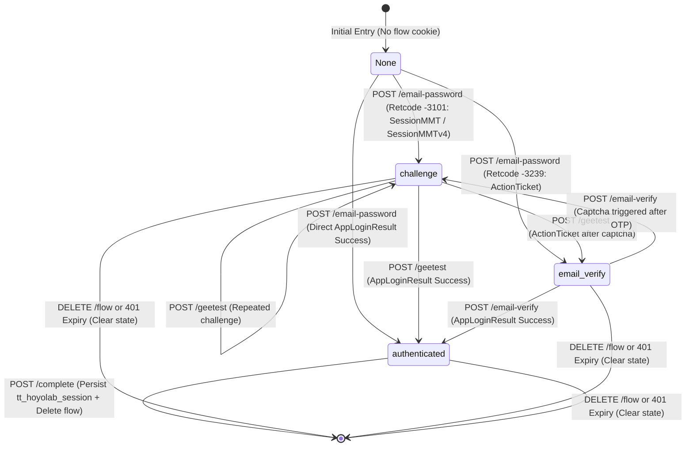

# HoYoLAB Email/Password Authentication Engine — Stage B1 Implementation

> **Document Status:** Backend Engine Implementation Complete & Mock Validated
> **Repository:** `travelers-toolkit`
> **Baseline:** `main` @ `ef45359`
> **Scope:** Backend API routes (`backend/hoyolab_auth.py`), shared session persistence (`backend/hoyolab_session.py`), and deterministic mock test suite (`backend/tests/test_hoyolab_auth.py`).
> **Notice:** No production frontend UI or live credentials were used. Automated tests run 100% offline with synthetic mock fixtures.

---

## 1. System Architecture

The HoYoLAB email/password authentication system is built on an isolated, security-first state machine that interfaces with HoYoverse's mobile app passport API (`ma-passport/api/appLoginByPassword`), exchanges intermediate credentials, discovers game accounts, and normalizes into Traveler's Toolkit's existing session format (`tt_hoyolab_session`).

```
┌──────────────────────────────────────────────────────────────────────────────────┐
│                             BROWSER / CLIENT                                     │
└────────────┬────────────────────────┬───────────────────────┬────────────────────┘
             │ 1. POST /email-password│ 2. POST /geetest      │ 3. POST /email-verify
             │                        │    (if challenge)     │    (if 2FA)
             â–¼                        â–¼                       â–¼
┌──────────────────────────────────────────────────────────────────────────────────┐
│                   FASTAPI ROUTER (/api/hoyolab/auth)                              │
│                                                                                  │
│   • Request Validation: Pydantic ConfigDict(extra="forbid")                      │
│   • Flow State Cookie: Fernet-encrypted 'tt_hoyolab_flow_state' (TTL <= 600s)   │
│   • Cookie Size Guard: <= 3500 bytes hard ceiling                                │
│   • State Transitions: credentials -> challenge / email_verify -> authenticated │
└────────────┬─────────────────────────────────────────────────────────────────────┘
             │ Outbound Requests via genshin.Client
             â–¼
┌──────────────────────────────────────────────────────────────────────────────────┐
│                   HOYOVERSE APP PASSPORT SERVICE                                 │
│                   (sg-public-api.hoyoverse.com)                                  │
│                                                                                  │
│   • AppLoginByPassword: RSA-encrypted password + Dynamic Secret (DS)            │
│   • GetBySToken: Token exchange (stoken -> ltoken_v2)                           │
│   • GetUserGameRolesByCookie: Account discovery                                  │
└────────────┬─────────────────────────────────────────────────────────────────────┘
             │
             â–¼ 4. GET /accounts (filters Genshin Impact accounts only)
             â–¼ 5. POST /complete (selects 1 UID -> creates tt_hoyolab_session)
┌──────────────────────────────────────────────────────────────────────────────────┐
│                     FINAL STATE & NORMALIZATION                                  │
│                                                                                  │
│   • Validates credentials against upstream notes endpoint                        │
│   • Sets permanent 'tt_hoyolab_session' ({version: 1, ltuid, ltoken})            │
│   • Deletes temporary 'tt_hoyolab_flow_state' cookie                             │
│   • Zero password retention: Passwords purged on entering 'authenticated' stage  │
└──────────────────────────────────────────────────────────────────────────────────┘
```

---

## 2. Finite State Machine

The authentication flow progresses through four distinct stages:



### Stage Definitions & Invariants

| Stage | Allowed Endpoints | Contained Data in Encrypted Flow State | Password Retained? |
|---|---|---|---|
| `challenge` | `POST /geetest`, `DELETE /flow` | `purpose`, `version`, `stage`, `challenge_context` (`app_login` or `send_email`), `device_id`, `account`, `password`, `gt_version`, `session_id`, `action_ticket` (if `send_email`) | **Yes (Temporary)** — needed to retry `_app_login` or email dispatch |
| `email_verify` | `POST /email-verify`, `DELETE /flow` | `purpose`, `version`, `stage`, `device_id`, `account`, `password`, `action_ticket` | **Yes (Temporary)** — needed to retry `_app_login` with ticket |
| `authenticated` | `GET /accounts`, `POST /complete`, `DELETE /flow` | `purpose`, `version`, `stage`, `device_id`, `cookies: {ltuid_v2, ltoken_v2}` | **NO — Completely Purged** |

---

## 3. Cookie Schemas

### 3.1 Temporary Flow Cookie: `tt_hoyolab_flow_state`
- **Name:** `tt_hoyolab_flow_state`
- **Lifecycle:** Created on login initiation; updated on challenge transitions; deleted upon `/complete` or `/flow` deletion.
- **Max Age / TTL:** 600 seconds (10 minutes).
- **Transport Flags:** `HttpOnly=True`, `SameSite="lax"`, `Path="/"`, `Secure=IS_PRODUCTION`.
- **Payload Schema (Plaintext prior to Fernet encryption):**
  ```json
  {
    "purpose": "hoyolab-login-flow",
    "version": 1,
    "stage": "credentials | challenge | email_verify | authenticated",
    "challenge_context": "app_login | send_email",
    "created_at": 1710000000,
    "device_id": "a1b2c3d4e5f6g7h8",
    "account": "user@example.com",
    "password": "...",
    "session_id": "...",
    "gt_version": 3,
    "action_ticket": {
      "risk_ticket": "...",
      "verify_str": { "ticket": "...", "verify_type": "email" }
    },
    "cookies": {
      "ltuid_v2": "100000001",
      "ltoken_v2": "..."
    }
  }
  ```
- **Size Safety Guard:** A strict application ceiling of **<= 3500 bytes** is measured on the **FINAL Fernet-encrypted ciphertext** passed to `set_cookie()`, not the pre-encryption plaintext. If the resulting ciphertext token exceeds 3500 bytes, the server aborts safely with HTTP 500 without setting an oversized Set-Cookie header.

### 3.2 Persistent Session Cookie: `tt_hoyolab_session`
- **Name:** `tt_hoyolab_session`
- **Lifecycle:** 30 days (`SESSION_COOKIE_MAX_AGE = 30 * 24 * 60 * 60`).
- **Transport Flags:** `HttpOnly=True`, `SameSite="lax"`, `Path="/"`, `Secure=IS_PRODUCTION`.
- **Payload Schema:**
  ```json
  {
    "version": 1,
    "ltuid": "100000001",
    "ltoken": "v2_ltoken_..."
  }
  ```
- **UID Semantics:** UID is **NOT** stored inside the persistent `tt_hoyolab_session` cookie. The persistent session contains strictly `{version, ltuid, ltoken}` with `ltuid` preserved as a `str`. The selected UID is verified upstream and returned in the `POST /api/hoyolab/auth/complete` JSON response so the frontend can store and bind it via Traveler's Toolkit's existing user store / UID pathway.
- **Invariant:** Unchanged from manual cookie entry. Downstream services (`/api/notes`, `/api/hoyolab/achievements`, `/api/hoyolab/character-sync-preview`) interact with identical credentials.

---

## 4. Security Invariants & Logging Ban

1. **Zero Credential Logging:** No logger statements output accounts, emails, passwords, verification codes, action tickets, or auth cookies. Only sanitized category labels are emitted (e.g. `"HoYoLAB login flow initiated"`, `"HoYoLAB app login upstream error: InvalidCookies"`).
2. **Immediate Password Purge:** The user's password exists in memory only during the active HTTP request, and inside the temporary Fernet cookie only while in `challenge` or `email_verify` stages. As soon as authentication completes and transitions to `stage="authenticated"`, the password is deleted from state.
3. **Token Non-Exposure:** Raw session tokens (`stoken`, `ltoken_v2`) and cookies are never returned in JSON response bodies. The frontend only receives control directives (`nextStep: "complete" | "geetest" | "emailVerify"`) and public game account summaries (`uid`, `nickname`, `server`, `level`).
4. **Tamper & TTL Protection:** Modifying the flow state cookie causes Fernet HMAC verification failure, returning HTTP 401 and purging the cookie. Expired tokens (>600s) are rejected deterministically.

---

## 5. Safe Error Mapping

Upstream HoYoverse errors are mapped to deterministic, friendly HTTP responses without leaking raw exception strings:

| Condition | Upstream Event / Error | Response Status | Safe Detail |
|---|---|---|---|
| Invalid Credentials | `InvalidCookies` / retcode `-3201` | 401 Unauthorized | `"Invalid account or password."` |
| Upstream Rate Limit | retcode `-3205` / "Too many requests" | 429 Too Many Requests | `"Too many attempts. Please try again later."` |
| Invalid Verification OTP | `_verify_email` failure / retcode `-3203` | 400 Bad Request | `"Invalid or expired verification code."` |
| Unassociated UID | UID not in discovered account list | 400 Bad Request | `"Selected UID is not associated with this HoYoLAB account."` |
| Invalid Stage Transition | Calling `/email-verify` while not in `email_verify` | 400 Bad Request | `"Invalid flow stage for email verification."` |
| Expired / Corrupted Flow | Expired TTL or invalid Fernet token | 401 Unauthorized | `"Authentication flow expired or invalid."` |
| Upstream Network Timeout | Timeout > `UPSTREAM_TIMEOUT_SECONDS` | 504 Gateway Timeout | `"Upstream request timed out. Please try again later."` |
| Upstream Outage | Unhandled `GenshinException` | 502 Bad Gateway | `"HoYoLAB authentication service is temporarily unavailable."` |
| Unexpected Crash | Uncaught general Exception | 500 Internal Error | `"Internal server error."` |

---

## 6. Residential Proxy Hook & Vercel Considerations

- **Current Status:** Upstream Hoyo Buddy uses `CONFIG.residential_proxy` for overseas login.
- **Traveler's Toolkit Implementation:** Added optional environment hook `HOYOLAB_LOGIN_PROXY = os.getenv("HOYOLAB_LOGIN_PROXY", "").strip() or None`. Defaults to `None`.
- **Classification:** **UNKNOWN / LIKELY RECOMMENDED** for production Vercel serverless. While local execution bypasses datacenter blocks naturally using the user's home residential connection, AWS/Vercel serverless egress may encounter anti-bot challenges or IP-discrepancy invalidation during multi-step flows. This uncertainty will be evaluated via controlled live tests before production deployment.

---

## 7. Rate Limiting Requirement (Launch Gate)

- **Stage B1 Status:** Mocked architecture tested. No in-memory rate limiter was added in B1 to avoid false security in distributed serverless environments.
- **Production Launch Requirement (Stage B3):** Before opening the email/password endpoint to public production traffic on Vercel, a distributed rate limiter (e.g. Upstash Redis or Vercel Firewall / Cloudflare WAF rate rules) must enforce per-IP limits (max 5 login attempts per 15 minutes) to protect against credential stuffing, email verification spamming, and HoYoverse egress IP blacklisting.

---

## 8. Manual Live Test Plan (Local Execution Only)

> **SAFETY MANDATE:** Do not execute this plan until requested by the user. Never ask for or record real credentials in chat. The user executes this strictly within their local development environment.

### Test Environment Prerequisites
1. Local backend running: `python -m uvicorn main:app --reload` (listening on `http://localhost:8000`).
2. Frontend development server running: `npm run dev` (listening on `http://localhost:5173`).
3. Valid HoYoverse overseas account with email & password credentials.

### Step-by-Step Test Procedure
1. **Audit Logs:** Ensure terminal running backend does not output sensitive request bodies.
2. **Execute Initial Login Request:**
   Submit account and password via local client:
   `POST http://localhost:8000/api/hoyolab/auth/email-password`
3. **Observe Response Branch:**
   - **Case A (Direct Complete):** Returns `{"nextStep": "complete"}`.
   - **Case B (Geetest Triggered):** Returns `{"nextStep": "geetest", "gtVersion": ...}`. Solve challenge and POST solution to `/geetest`.
   - **Case C (Email 2FA Triggered):** Returns `{"nextStep": "emailVerify"}`. Check email inbox for 6-digit code and POST to `/email-verify`.
4. **Discover Game Accounts:**
   Call `GET http://localhost:8000/api/hoyolab/auth/accounts` and confirm only Genshin Impact accounts with nickname, level, and UID are returned.
5. **Complete Sign-In:**
   Submit selected UID: `POST http://localhost:8000/api/hoyolab/auth/complete` with `{"uid": 8xxxxxxxx}`.
6. **Verify Normal Sync:**
   Call `/api/notes` or `/api/hoyolab/achievements` to confirm the resulting `tt_hoyolab_session` performs live data imports seamlessly.
7. **Clean Up:**
   Call `DELETE http://localhost:8000/api/hoyolab/session` to clear session cookies.

---

## 9. Draft Privacy Policy Disclosure (For Future Release)

Prior to releasing the automated login UI in production, the `/privacy` page (`src/pages/PrivacyPolicy.jsx`) must be updated with the following section:

> ### HoYoLAB Account Authentication
>
> If you choose to connect your HoYoLAB account using your email and password instead of manually pasting browser cookies:
> - **Transit Only:** Your login credentials are sent over encrypted HTTPS directly to our backend server, which communicates with HoYoverse's official mobile authentication service.
> - **Zero Password Storage:** Your password is never stored in persistent databases, local browser storage, or server logs. It is held only in temporary encrypted server memory during active multi-step authentication (such as solving a security challenge or entering an email verification code) and is immediately discarded once sign-in completes.
> - **Session Tokens:** Upon successful login, our server derives your HoYoLAB community session tokens (`ltuid_v2` and `ltoken_v2`) and encrypts them inside an HTTP-only session cookie in your browser.
> - **Independent Integration:** Traveler's Toolkit is an independent open-source project and is not affiliated with or endorsed by HoYoverse.

---

## 10. Frontend Stage B2 Plan

Once Stage B1 is accepted, Stage B2 will implement the client-side integration:
1. **Settings UI Update (`src/pages/Settings.jsx`):**
   - Provide clean choice: `[ Sign in with HoYoLAB ]` (automated) vs `[ Enter cookies manually ]` (fallback).
2. **Modal Flow Components:**
   - `EmailPasswordModal`: Clean inputs with `autocomplete="username"` and `autocomplete="current-password"`, accompanied by privacy disclaimer.
   - `GeetestModal`: Dynamic loader for `gt.0.5.0.js` or `gt4.js` triggered only when `nextStep === "geetest"`.
   - `EmailVerifyModal`: 6-digit OTP code input with resend and expiry countdown.
   - `AccountSelectModal`: Interactive cards displaying character nickname, server name, UID, and Adventure Rank.
3. **Session Reconnection:** Seamless transition into existing sync state upon completion.

---

## 11. Automated Test Suite Verification

The backend test suite executes 100% offline with synthetic mock data and zero live HoYoverse network traffic. All test numbers were mechanically derived from actual `python -m unittest discover` execution:

- **Full Backend Suite:** **129 tests passed** (0 failures, 0 errors).
- **New Authentication Engine (`backend/tests/test_hoyolab_auth.py`):** **26 tests passed**.

### Mechanically Derived Discovery Breakdown
- `backend/tests/test_achievements.py`: 50 tests passed
- `backend/tests/test_config.py`: 17 tests passed
- `backend/tests/test_hoyolab_auth.py`: 26 tests passed
- `backend/tests/test_hoyolab_character_sync.py`: 16 tests passed
- `backend/tests/test_security.py`: 20 tests passed
- **Total:** 129 tests passed
